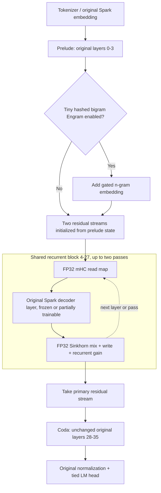

# SparkX-Loop v0.2 — Aggressive Depth-Recursive Retrofit

**Research and executable-prototype specification · 31 October 2026**  
**Base checkpoint:** [`XHToken/Spark-X2.6-4B`](https://huggingface.co/XHToken/Spark-X2.6-4B)  
**Direct architectural reference:** [`sensenova/SenseNova-Loop-9B-Preview`](https://huggingface.co/sensenova/SenseNova-Loop-9B-Preview)  
**Included executable prototype:** `SparkX_Loop_v02_OneShot_Colab.ipynb`, `sparkx_loop_core.py`, `load_inference.py`  
**Status:** design and CPU-tested interface prototype; **not** yet a validated trained Spark 4B loop model.  
**Compute assumption:** One uninterrupted Colab GPU session, nominally limited to 24 hours. One-shot training with automatic artifact exports; **no optimizer-state resume**.

---

## 0. Executive decision

The previous full Replica architecture is deliberately **out of scope**. We will modify the existing 36-layer, 4.112B-parameter Spark X2.6 into a *weight-sharing depth-recurrent Transformer*. No new tokenizer, modality tower, episodic record store, nested-learning algorithm, or new backbone from scratch is required.

The proposed v0.2 combines:

1. **Progressive depth recurrence:** a shared contiguous middle block runs once or twice, eventually targeting the **24-layer block `[4,28)`**, yielding **60 logical decoder-layer executions** from the original **36 unique layers**.
2. **Two-stream, Sinkhorn-normalized mHC at every layer of the recurrent block**, initialized close to Spark's original residual computation. Additional-pass gains initialize at zero, allowing the network to learn when and how much to use extra depth rather than immediately destroying pretrained representations.
3. **LoRA on original Spark attention and MLP projections**, shared naturally across recurrence passes; user-selectable **full training of a handful of existing decoder layers** when VRAM permits.
4. **Optional tiny hashed bigram Engram probe**, added after the early prelude. It is a learnable static lookup and **does not** constitute persistent episode memory or the full published Engram implementation.
5. **One-shot supervised adaptation** using a predefined public dataset, optional verified external teacher-generated examples, and automatic export to the user's private Hugging Face repository.

**Default experiment:** 24 warmup optimizer steps, 48 R8 steps, 56 R12 steps and 72 R24 steps; microbatch 1, gradient accumulation 4, sequence length 256. These are conservative *wiring/feasibility* defaults, **not sufficient to establish a scientific quality improvement**. The notebook has a configurable wall-clock cap of 19.5 hours to leave time for uploads.

The core hypothesis is **not** “more layers automatically reason better.” It is: *Can a pretrained compact Transformer be reconditioned to exploit an extra shared-weight depth pass, with stable learned residual routing, more efficiently than fine-tuning the original model with equal GPU time?*

---

## 1. Evidence and what can be copied from SenseNova

SenseNova's announced model, released **30 October 2026**, is relevant because it demonstrates the exact class of architecture we wish to retrofit: a contiguous repeated middle block with two residual streams and manifold-constrained mixing. The published model card says:

| Design fact | SenseNova-Loop-9B-Preview | SparkX-Loop v0.2 |
|---|---|---|
| Unique decoder layers | 32 | **36** (unchanged) |
| Looped block | `[4,28)` | **target `[4,28)`** |
| Passes through block | 2 | 1 at warmup; 2 later |
| Decoder executions | 56 | **36 / 44 / 48 / 60** by stage |
| Residual streams | 2 | 2, recurrent block only |
| Stream mixing | mHC with Sinkhorn | FP32 Sinkhorn; simplified custom read/write/gates |
| Attention | 3 linear + 1 full per four-layer group | **3 sliding-window + 1 full** per four-layer group |
| Multimodal | Images + text | **Text only for v0.2** |

The SenseNova model card identifies the architecture but its technical report was still listed as TBD at inspection. Reusing the concept does **not** imply reproducing its training procedure, inference kernels or benchmarks. Model-card benchmark claims are not independent evidence that our retrofitted 4B will improve. [1]

Relevant independent research supports the investigation:

- **Hyperloop Transformers**: depth-shared middle blocks plus hyper-connections at loop boundaries, parameter-efficient at matched inference conditions. Most of its results involve training looped architectures, so do not interpret them as guaranteed retrofitting performance. [2]
- **mHC**: doubly stochastic residual mixing stabilizes generalized residual pathways; constraining the mixing does not prove every nonlinear layer is stable. [3]
- **Retrofitted Recurrence**: staged recurrence curricula can help preserve a pretrained model's competence better than abrupt depth changes. [4]
- **mHC for PEFT**: mHC alone does not uniformly beat LoRA; mHC+LoRA sometimes improves performance at matched trainable capacity. This motivates the combination rather than an all-mHC experiment. [5]
- **Engram**: conditional learned n-gram lookups can complement neural computation; the prototype below is deliberately much smaller and simpler. [6]

---

## 2. Spark source contract: do not accidentally create a new model

The released Spark model's Python source uses `Spark2_5ForCausalLM` and the modules:

```text
base.model.embedding
base.model.layers[0..35]
    .self_attn.q_k_v_proj
    .self_attn.out_proj
    .self_attn.g_proj       # original head-wise attention gate
    .mlp.gate_proj
    .mlp.up_proj
    .mlp.down_proj
    .input_layernorm
    .post_attention_layernorm
base.model.norm
base.lm_head
```

From the inspected source and the prior Spark blueprint:

| Property | Requirement |
|---|---|
| Unique base parameters | Approximately 4,112,079,360 |
| Layers / hidden / FFN | **36 / 2560 / 10240** |
| Heads | **16 Q**, **4 K/V**, head dimension **256** |
| Attention | Repeating `sliding/sliding/sliding/full`, window **512** for sliding layers |
| QKV projection | A **single fused** `q_k_v_proj` (not a Llama-style trio of linear layers) |
| MLP | Original **GELU-gated** MLP; **do not** substitute SwiGLU |
| RoPE | Layer-type-specific rotary factors and theta; preserve original geometry |
| Original output | Final RMS normalization followed by original tied LM head |

**Importantly:** Spark's sliding attention is *not* SenseNova's linear attention. Do not convert Spark to linear attention in this v0.2 experiment. That would require additional substantial training and destroys the clear causal test of recurrence. Inference code cannot simply reuse a layer-index-keyed cache when those same logical layers appear multiple times per decoding step. [7,8]

The notebook recreates upstream `Spark2_5Model.forward`'s mask selection, per-attention-type RoPE and final norm/head, while explicitly disabling all KV cache usage. It will refuse to proceed if the runtime model no longer has 36 layers of width 2560.

**Upstream remote-code risk:** `trust_remote_code=True` executes model-repository Python. Review the repository and pin `MODEL_REVISION` to a tested commit before conducting a definitive experiment. The included first-pass example defaults to `main` for ease of starting; that is not reproducible indefinitely.

---

## 3. Proposed architecture



### 3.1 Depth accounting

Let `B_[a:b]` be the original Spark layers `a..b-1`. An ordinary Spark pass is:

\[
H_{36}=B_{[28:36]}\circ B_{[4:28]}\circ B_{[0:4]}(H_0).
\]

The R24 variant executes the same stored middle block twice:

\[
H_{60}=B_{[28:36]}\circ B_{[4:28]}\circ B_{[4:28]}\circ B_{[0:4]}(H_0),
\]

with trained residual routing around those shared layers. Its **stored** layer count remains 36, while **logical executed** layers equal `36+24=60`. The **added** computational work is approximately 24/36 = 67% more decoder-layer evaluations at inference, excluding routing and non-layer overhead. Do not confuse this with a 67% speed decrease or a 67% increase in trainable parameters.

| Stage | Extra depth block | Executed layers | Initial objective |
|---|---|---:|---|
| Prelude/warmup | none; `[4,12)` once | 36 | Preserve pretrained behavior; initialize adapters |
| R8 | `[4,12)` twice | 44 | Teach a short extra pass |
| R12 | `[4,16)` twice | 48 | Expand repeated depth |
| R24 | `[4,28)` twice | 60 | SenseNova-style aggressive block size |

The base checkpoint is unchanged before adapters are inserted; the same physical layer and LoRA matrices are executed again during the extra pass.

### 3.2 Two-stream mHC math

For each recurrent layer, let two residual streams be \(S=(s_0,s_1)\), each of shape `[batch,seq,2560]`. Let \(r\) be softmax-normalized read weights, \(w\) write weights and \(P\) a nonnegative 2×2 Sinkhorn-normalized mixing matrix:

\[
\mathbf{1}^T P=\mathbf{1}^T,\quad P\mathbf{1}=\mathbf{1},\quad P_{ij}\ge 0.
\]

The prototype calculates:

\[
\begin{aligned}
 x &= r_0s_0+r_1s_1,\\
 \Delta &= \mathrm{SparkLayer}_\ell(x)-x,\\
 P &= \mathrm{Sinkhorn}(A_\ell),\\
 P_{\mathrm{eff}} &= I+g_{p,\ell}(P-I),\\
 S' &= P_{\mathrm{eff}}S+g_{p,\ell}\,w\otimes\Delta.
\end{aligned}
\]

The first pass uses \(g_{0,\ell}=1\); the additional pass uses \(g_{1,\ell}=\tanh(\gamma_\ell)\), initialized at zero. Sinkhorn and controller weights are kept in FP32. The read/write logits initially select primary stream 0 and the mixing matrix initially approximates identity.

**Why the additional-pass zero gate matters:** blindly applying a pretrained decoder block a second time gives it states from an unfamiliar depth distribution. An extra-pass gate initialized to zero yields an exact no-op on that additional pass at initialization, allowing training to open the loop gradually. This is a *candidate stabilization technique*, not proof of eventual improvement.

This is a **custom two-stream mHC-inspired residual controller**, not bit-for-bit DeepSeek mHC and not necessarily SenseNova's internal implementation. The core is intentionally small and inspectable. A controlled ablation must compare no mixer, fixed-identity mixer, and learned Sinkhorn mixer.

### 3.3 Loop-specific LoRA or shared LoRA?

The supplied prototype uses **shared LoRA**, attached once to the actual stored decoder layers. Consequently, LoRA receives gradients from both loop passes while adding no per-pass weight matrices. This is the cheapest implementation and keeps serialization simple.

**Higher-risk extension:** add pass-specific low-rank deltas `LoRA_pass0`/`LoRA_pass1`, sharing the 4B pretrained weights but allowing different adaptation for second-pass states. Implement only after shared-LoRA R24 has a stable baseline. The extra adapter storage can be modest, but effects on training and attribution must be measured.

### 3.4 Optional small Engram

The probe uses a deterministic **causal bigram hash** with previous/current token IDs:

\[
h_t=(1000003\cdot id_{t-1}+9176\cdot id_t+29)\bmod N.
\]

The hashed bucket index selects a learnable `Embedding(N,d)` and a linear projection to Spark's 2560-wide residual state. For the default `N=16384`, `d=64`, the embedding itself has ~1.05M parameters and the projection has ~0.16M parameters, plus a scalar gate. The projection is initially zero, preserving upstream behavior at insertion.

This small memory is intentionally **static at inference** and will have hash collisions. It is not a database, has no provenance, cannot update episodic facts during a conversation, and is not the full multi-gram/conditional-memory formulation in the Engram research. Enable/disable it to measure whether early lexical lookup helps or merely adds noise.

---

## 4. Exactly which weights are trainable

The base model is loaded and completely frozen first. The training script then installs LoRA and selectively unfreezes a few original layers. This avoids the optimizer and gradient memory cost of updating all 4.1B original parameters.

| Module | Default state | Rationale |
|---|---|---|
| Original embedding / LM head | Frozen | Preserve original language and vocabulary mapping |
| Original decoder 0–35 | Frozen except selected | Preserve pretrained competence |
| Fused QKV + attention out projections, layers 4–35 | LoRA rank 8, scale 16 | Adapt feature extraction and output over repeated depths |
| GELU MLP gate/up/down projections, layers 4–35 | LoRA rank 8 | Adapt repeated intermediate states |
| mHC routing (two-stream) in layers 4–27 | Trainable FP32 | Learn mixing and additional-pass strength |
| Hashed Engram and projection | Trainable FP32 | Optional lookup experiment |
| Full original layers | `[32,33]` if Colab GPU ≥55 GiB; otherwise none | Allow limited full-backbone adaptation without full-model optimizer |

On a high-VRAM runtime, a follow-up experiment may unfreeze `[24,25,32,33]` or all the coda `[28,35]`, with its own memory gate and ablation. Do not unfreeze arbitrary full layers on a 24 GB card and assume it fits.

**Optimizer defaults:** AdamW adapter learning rate `1e-4`; fully unfrozen original weights `2e-6`; gradient clipping 1.0. The rate separation prevents newly initialized routing from forcing aggressive updates onto pretrained weights. These are initial settings, not tuned best values.

---

## 5. One-shot Colab training contract

### 5.1 What “one shot” means here

- **Run all notebook cells once** in a GPU Colab session.
- Install deps, load HF base, verify interfaces, load supervision, optionally request OpenCode teacher examples, train four stages sequentially, evaluate, and export.
- **No `resume_from_checkpoint`**, optimizer-state serialization, multi-session scheduler or dependency on files kept between Colab sessions.
- **Export trained weights** to a private HF model repository **after each stage** and again with final metrics. These are stage *outputs*, not resume checkpoints. This protects completed work if the ephemeral runtime is later deleted.
- Cap training at **19.5 hours** from notebook start by default. An actual runtime can end earlier than the nominal 24-hour maximum, so successful final export is never guaranteed if interrupted suddenly. After a stage upload, however, that exported artifact survives the Colab filesystem.

If you truly want one export at the very end, set `UPLOAD_EACH_STAGE=False`; this increases the chance of losing all results from an unexpected disconnect.

### 5.2 Secrets and API handling

Configure **Colab Secrets** via the key icon, then grant notebook access. The notebook accepts:

| Name | Purpose | Required? |
|---|---|---|
| `HF_TOKEN` | Download base and create/upload private HF output | Yes, if `PUSH_TO_HF=True` |
| `HF_TOKEM` | Alias for the spelling supplied in the conversation | Optional alias |
| `OPENCODE_API` | API key for an external supervisor model | Only if teacher mode is enabled |

The notebook never asks you to paste keys into code. It does not print them, save them in JSON exports, or upload them to the model repository.

The OpenCode API path is **optional and disabled by default**. When enabled, set `TEACHER_MODEL` to an available model ID and confirm `OPENCODE_BASE_URL` for your OpenCode account. The code uses the OpenAI-compatible endpoint (`https://opencode.ai/inference/openai/v1` in the checked Console docs). API calls may cost money and count toward provider rate limits. [9]

**A teacher call is not, by itself, RL.** In this prototype, the teacher proposes math answers, the code checks the final numeric answer against the held-out original training label, and only verified proposals replace the training answer for supervised distillation. No unverified teacher grades are trusted. True GRPO or other reward-model optimization is a separate, opt-in extension and is intentionally absent from the one-shot baseline.

### 5.3 Dataset: why GSM8K first

The notebook streams [`openai/gsm8k`](https://huggingface.co/datasets/openai/gsm8k) with independent train and test splits. It uses assistant-token-only next-token CE training and has explicit final numeric answers that support basic external-teacher verification. This is an easy *wiring and optimization* dataset, not sufficient for general reasoning, coding, language retention, or latent-iteration claims.

For a publishable comparison, add a broader train mix and independent validation data after the base pipeline is stable: math, coding/tests, instruction-following, structured planning, and one genuinely loop-beneficial multi-step benchmark. A candidate instruction dataset is [`HuggingFaceH4/ultrachat_200k`](https://huggingface.co/datasets/HuggingFaceH4/ultrachat_200k) (`train_sft`/`test_sft`), but the included notebook intentionally does not make this a dependency. [10]

Data-quality rules:

1. Keep evaluation/test questions out of training, augmentation and teacher calls.
2. Store the source split, record count and dataset revision for later scientific reports.
3. Reject malformed or unverified teacher responses; compare numeric answers in canonical numerical form, not by string stripping.
4. Do not interpret lowered teacher-forced loss as proof that free-generation reasoning improved.

---

## 6. Hardware, precision and resource planning

### 6.1 Memory

A BF16 weight-only original Spark checkpoint of 4.112B parameters occupies approximately:

\[
4.112\times10^9\times2\;\mathrm{bytes}\;\approx\;7.66\;\mathrm{GiB}.
\]

This omits the adapter states, full-layer gradients/moments, forward/backward activations, CUDA libraries, attention matrices and temporary tensors. A recurrent forward saves stored parameters but performs extra **work** and (unless checkpointed) saves more intermediate activations. The prototype checkpoints recurrent layers during training.

| Colab GPU situation | Practical interpretation |
|---|---|
| 16 GB T4 class | Not recommended; pipeline fails fast below 20 GiB |
| 24 GB GPU | First functional R8/R12 experiment, short sequences, no fully unfrozen layers; R24 may OOM |
| 40–48 GB GPU | Better chance for R24 at 128–256 tokens; profile before long runs |
| A100/H100 80 GB | Preferred for R24 and selected original full-layer updates |
| 96 GB-class GPU | More flexibility for larger sequences and partial unfreezing, but not needed for basic proof |

The notebook picks BF16 where supported; an FP16 fallback is offered but not qualified for stability. It intentionally avoids 4-bit quantization of the base because this custom routing path and selected full-layer updates need proper non-quantized training behavior. VRAM and walltime must be measured live; **no tokens/second or GPU-hour promise is made**.

### 6.2 Compute accounting

For an `n`-layer original model and an `r`-layer region repeated one extra time, layer execution changes from `n` to `n+r` but *stored backbone parameters* remain `n` layers. In R24, 36→60 executions, an idealized 1.67× layer-compute multiplier. Training backprop, checkpoint recomputation, original Spark's eager attention and new residual mixing can make real walltime much worse than that simple ratio.

Do not equate SenseNova's 56-layer inference execution with our 60-layer runtime speed. Spark's attention kernels and sequence lengths differ.

---

## 7. Notebook implementation and execution order

The included `.ipynb` is **self-contained**: it embeds the full core Python source in a `%%writefile` cell and also writes a post-training loader. It does not require downloading any separate script to train.

1. **Environment:** install the Spark-compatible `transformers==4.57.1`, `accelerate`, `datasets`, `safetensors`, `huggingface_hub`, and OpenAI client; keep the Colab-provided PyTorch GPU build.
2. **Settings:** choose GPU-specific `MAX_SEQ_LENGTH`, optional `FULL_LAYERS`, four stage lengths, private repository, and teacher budget.
3. **Secret lookup:** read `HF_TOKEN` or `HF_TOKEM`; `OPENCODE_API` only if teacher mode is on. Require a GPU with at least 20 GiB for the provided default implementation.
4. **Build core:** define `LoRALinear`, `HashedBigramEngram`, `TwoStreamMHC`, `SparkXLoop`, selective unfreezing, param groups and export helpers.
5. **Model load:** load official Spark checkpoint and tokenizer; attach LoRA to layers 4–35; create controller bank 4–27.
6. **Fail-fast contract checks:** test original-model parity when recurrence/mHC/Engram are disabled; check mHC row/column sums and finite forward outputs.
7. **Dataset:** streaming GSM8K with assistant-only training labels and independent test data.
8. **Teacher (optional):** bounded OpenCode proposals with numeric answer verification. Disabled by default.
9. **Export repo setup:** test permissions by creating the private HF repository **before costly training**.
10. **Baseline:** original single-pass held-out NLL estimate.
11. **Training:** warmup → R8 → R12 → R24, carrying the same optimizer across stages. Gradient accumulation, layer checkpointing and clipping are enabled.
12. **Exports:** save trainable tensors, exact stage depth, model metadata, training metrics, core Python, and post-training loader; upload to `stages/{stage}`.
13. **Summary and smoke generation:** write evaluation log and use uncached greedy generation for a short prompt. This is a correctness check, not a production-speed benchmark.

**Important code path:** `SparkXLoop.forward_logits()` invokes original layers in the desired order with `past_key_values=None`. For all training and test generation, call the wrapper. **Do not call `base.generate()`** and assume the loop is executed; that invokes the untouched model's forward path.

---

## 8. Evaluation and hard acceptance gates

The notebook includes fundamental smoke gates, but a scientific claim should require the following broader matrix. Compare variants at **matched compute, matched training tokens and matched wall time** separately.

| Gate | Test | Failure interpretation |
|---|---|---|
| 0. Code/shape | Exact 36×2560 Spark interface | Upstream API changed; stop before training |
| 1. Frozen parity | 1-pass/no-mHC/no-Engram wrapper ≈ original logits | Mask, RoPE, dtypes or head path mismatched |
| 2. Causality | Changing future tokens cannot affect logits for earlier positions | Invalid causal attention or Engram token indexing |
| 3. mHC invariants | FP32 mixing matrix nonnegative with row/column sums ≈1 | Broken Sinkhorn or numerical overflow |
| 4. Actual recurrent grads | Extra-pass gate and LoRA receive nonzero useful gradients | Dead recursion even though code loops |
| 5. Stability | Finite loss and gradient norms at each stage | Repeated depth destabilized the representation |
| 6. Original retention | Held-out general instructions/math/code do not degrade beyond a preregistered margin | Extra recurrence harms pretrained competence |
| 7. Loop benefit | R24 > equal-compute baseline on task-level **generated answers** | Increased depth offers no demonstrated benefit |
| 8. Ablation | mHC+LoRA vs LoRA-only vs identity mixing vs Engram-on/off | No causal attribution |
| 9. Performance | GPU peak VRAM, wall seconds/token, tokens/second and energy if available | Product impractical even if loss improves |

Set numeric acceptance thresholds *before* looking at final results; the initial notebook does not invent them. Log model git revision, dataset revisions, GPU type, dtype, token budget, actual optimizer steps, and all artifacts for a reproducible experiment.

**Ablations I recommend after first working run:**

- **A0 Original Spark** unchanged, no extra pass.
- **A1 Shared-weight extra pass, no mHC** (naive recurrence negative control).
- **A2 mHC only**, no LoRA, low capacity.
- **A3 LoRA only**, learned recurrence gate with identity residual mixing.
- **A4 mHC + LoRA** (main architecture).
- **A5 A4 + hashed Engram** (small optional enhancement).
- **A6 A4 + selected full coda layers** (compute/memory intensive).

Do not add fresh modality encoders or Replica memory components until A4 has shown a reproducible benefit on this smaller question.

---

## 9. Known technical limitations and troubleshooting

### 9.1 Inference is deliberately slow

The prototype has **no depth-specific KV cache**. `generate_slow()` reprocesses the complete context for each generated token, with every recurrent layer executed each time. This avoids the subtle bug of writing two logical depth passes into the same cache slot, but it will be much slower than native Spark deployment. A production looped decoder needs a cache schema such as `cache[(loop_pass, original_layer_idx)]` with correct handling of sliding-window eviction, full-attention positions, and reuse across generated tokens. Only then should attention-kernel optimization or quantization be attempted.

### 9.2 Full 4B checkpoint not validated here

The bundled `test_loop_core.py` verifies **CPU-level** structural behavior on a deliberately tiny Spark-shaped mock: disabled-extension parity, recurrent forward, Sinkhorn row/column constraints, optional Engram, gradient delivery to mHC/LoRA/selectively unfrozen layers. This is **not** a full-model GPU training receipt. Real HF model loading, custom masks, BF16 stability, Colab hardware, Hub uploads and actual training performance must be validated in the notebook's contract cells. The notebook stops before training if those checks fail.

### 9.3 OOM, nonfinite loss or low quality

- On OOM, first reduce `MAX_SEQ_LENGTH=128`; then `GRAD_ACCUM_STEPS=1` and `FULL_LAYERS=[]`. Gradient accumulation changes effective batch size; document it. If R24 still OOM, use a larger GPU rather than silently changing the experiment.
- If nonfinite loss appears, abort and inspect FP32 Sinkhorn values, BF16 support, trainable layer selection and LR. Do not automatically accept invalid results.
- If the extra pass never contributes, inspect the `extra_gain` values and gradients. A repeated layer with extra gate permanently zero is computationally pointless, even if R24 executes syntactically.
- If validation improves but task-level answers worsen, measure short final answer correctness and original abilities. Teacher-forced loss is insufficient for model-quality claims.
- If `create_causal_mask` or `compute_rope_cos_sin` interface changes, use the version-pinned Spark implementation; do not invent a simplified global mask that ignores local attention.
- If an HF upload fails, **do not assume Colab data will survive**. The notebook's local files are temporary; ensure the repo exists and the token has write rights before training.

---

## 10. Optional future path to supervised RL (not included in the baseline notebook)

A future SIRSL or teacher-RL phase is interesting *after* an SFT-trained recurrent model demonstrates that the extra pass is actually used.

1. Generate two or more answers per prompt from the **looped wrapper**, using correct uncached inference until depth-specific KV caches are implemented.
2. Score correctness with an **independent verifier**: exact math answer, unit tests for coding, formal proof checks where available. External teacher scores may add a bounded quality signal but should not be the only verifier.
3. Train with a well-specified objective (GRPO, REINFORCE with baseline, or preference optimization) and a KL anchor to the source model. A higher scorer preference is not itself evidence of ground-truth correctness.
4. Keep teacher model ID, prompt, responses, reward, model version, and API cost ledger, excluding credentials.
5. Compare RL after recurrence to an equal-compute original Spark RL baseline. Do **not** describe verified-teacher SFT as RL.

OpenCode is optional; do not couple the core architecture to an online paid API. The current notebook is fully trainable without the teacher key.

---

## 11. Post-session usage

With `PUSH_TO_HF=True`, Colab creates a private repository and uploads stage-specific data under:

```text
<HF_USERNAME>/sparkx-loop-v02/
  one_shot_metrics.json
  stages/
    warmup/
    R8/
    R12/
    R24/
       trainable.safetensors
       loop_config.json
       sparkx_loop_core.py
       load_inference.py
       README.md
```

If a stage is incomplete or did not run, its directory will not be present. A mid-stage error may instead export `partial_on_exception`. The exported `trainable.safetensors` holds only the trainable LoRA/mHC/Engram and selected backbone tensors, **not** all original 4.112B pretrained weights. The reconstruction process downloads the original Spark checkpoint again, builds the same adapters and controller, loads the trainable tensors, and calls the loop wrapper for generation.

From a GPU machine after training:

```bash
pip install torch transformers==4.57.1 accelerate safetensors huggingface_hub
export HF_TOKEN='your_token_in_your_shell_only'
export LOOP_REPO='your-hf-username/sparkx-loop-v02'
export LOOP_STAGE='R24'
python load_inference.py
```

`load_inference.py` is bundled with this deliverable and with each stage export. The run never depends on an existing Colab session. For the loader, use a trusted environment and never commit the shell token or Colab secret to version control.

---

## 12. Recommended immediate choices

The most defensible first experiment is **not** a 24-hour full-parameter fine-tune. Use the single-run notebook on a high-memory Colab GPU with:

```yaml
model: XHToken/Spark-X2.6-4B
model_revision: main              # replace with tested commit hash
primary_target: R24               # layers 4..27 repeated twice
training: BF16 + shared LoRA rank 8
mhc: 2 streams, FP32 Sinkhorn
engram: true                    # report Engram-off ablation later
full_layers: auto               # [32,33] on >=55 GiB GPU; [] otherwise
dataset: openai/gsm8k/main
teacher: disabled               # turn on only after confirming provider and model
session: one_shot
resume: false
runtime_cap_hours: 19.5
export: private_huggingface_hub
```

After the first run, make a decision from **actual** GPU memory, training loss, held-out loss, output behavior and extra-pass gate gradients. If the model is stable but unimproved, run the ablations before increasing dataset size. If the loop is demonstrably useful, extend instruction/reasoning data and only then consider more original-layer unfreezing, pass-specific LoRA, or production KV-cache work.

---

## 13. Source bibliography

1. SenseNova. (2026-10-30). *SenseNova-Loop-9B-Preview model card*. https://huggingface.co/sensenova/SenseNova-Loop-9B-Preview
2. Zeitoun, A., Torroba-Hennigen, L., & Kim, Y. (2026). *Hyperloop Transformers*. arXiv:2604.21254. https://arxiv.org/abs/2604.21254
3. Xie, Z., et al. (2025/2026). *mHC: Manifold-Constrained Hyper-Connections*. arXiv:2512.24880. https://arxiv.org/abs/2512.24880
4. McLeish, S., et al. (2025). *Teaching Pretrained Language Models to Think Deeper with Retrofitted Recurrence*. arXiv:2511.07384. https://arxiv.org/abs/2511.07384
5. Oldenburg, V., et al. (2026). *Manifold-Constrained Hyper-Connections for Parameter-Efficient Finetuning*. arXiv:2607.18130. https://arxiv.org/abs/2607.18130
6. Cheng, X., et al. (2026). *Conditional Memory via Scalable Lookup: A New Axis of Sparsity for Large Language Models*. arXiv:2601.07372. https://arxiv.org/abs/2601.07372
7. XHToken. *Spark-X2.6-4B model card and fine-tuning guide*. https://huggingface.co/XHToken/Spark-X2.6-4B
8. XHToken. *Spark Python model implementation (`modeling_spark.py`)*. https://huggingface.co/XHToken/Spark-X2.6-4B/blob/main/modeling_spark.py
9. OpenCode. *Console: Models, endpoints, Base URLs*. https://dev.opencode.ai/v2/docs/console/models
10. HuggingFaceH4. *UltraChat 200k dataset card*. https://huggingface.co/datasets/HuggingFaceH4/ultrachat_200k

### Artifact/testing provenance

- `sparkx_loop_core.py`: custom research implementation authored for this prototype, not an upstream model code replacement.
- `test_loop_core.py`: CPU mock structural assertions run successfully on an installed PyTorch CPU runtime.
- `SparkX_Loop_v02_OneShot_Colab.ipynb`: notebook structure and code-cell compilation validated offline; GPU/HF/API end-to-end not tested in this environment.
- `load_inference.py`: reconstruction script, syntax checked offline, requires a real exported stage and GPU to validate end-to-end.

**Scope boundary:** this document supersedes the earlier broader plan *only for this limited looped Spark experiment*. It does not imply prior SparkX multimodal/memory experiments have been completed or accepted.
