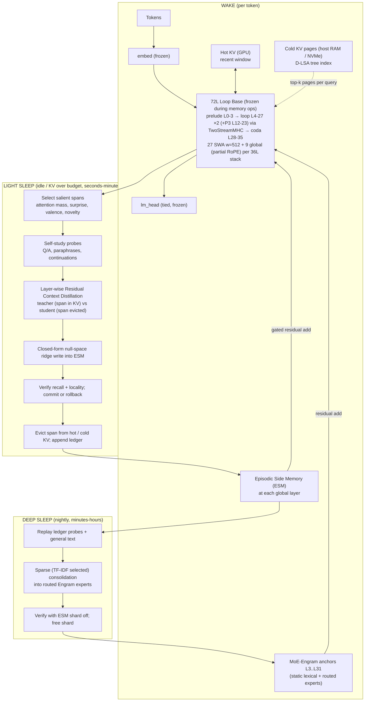
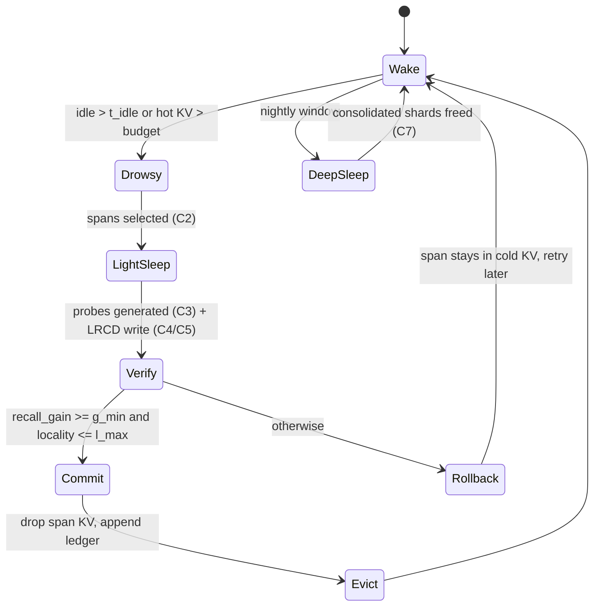

# 01 — Target Architecture & Component Design

> Built on the verified facts in [`00_REVIEW_AND_VERIFIED_FACTS.md`](00_REVIEW_AND_VERIFIED_FACTS.md). Each component lists **Why** (motivation + evidence), **How** (mechanism), **Implement & integrate** (where it plugs into this repo), and **Refinement of the current code**.

---

## 0. Design Principles

1. **Frozen backbone, always.** `XHToken/Spark-X2.6-4B` weights are never written by the memory system. Every learned or compiled parameter lives in a separately saveable module. (Why: no trillion-token budget; clean ablations; exact rollback.)
2. **Horizontal = working attention, vertical = long-term memory.** The context window holds what the model is actively working on. Long-term episodic knowledge is written into **mid-layer residual modules** and read without re-tokenising anything through `Layer 0`.
3. **Measure, don't assume equivalence.** Every write reports its residual fit error, recall gain and locality cost. Nothing is claimed "exact" or "zero" unless measured.
4. **The Loop Base is the base (decision 2026-11-03).** The deployed and evaluated network is the **72L Loop Base** (LB):
   - frozen Spark backbone weights;
   - prelude `L0–3` → looped core `L4–27` × 2 passes (+ optional P3 over `L12–23`) mixed by **24 `TwoStreamMHC`** controllers → coda `L28–35`;
   - optional MoE-Engram anchors.

   All memory work (**Track M**) is built, compiled and evaluated **on LB**. **Track L** is no longer an optional branch. It *repairs and strengthens* LB (loop curriculum, mHC health, Engram repair) and is a prerequisite for Track M. The 36L configuration (same weights, loop off) is kept **only as an ablation row**, so the paper can attribute effects to the loop. Rationale: storage and manipulation are complementary (see C9 §Why).
5. **Everything reversible.** Each memory write is an additive, logged delta that can be removed exactly.

---

## 1. System Overview



### 1.1 Memory hierarchy and timescales (Nested Learning view)

| Level | Store | Update frequency | Write mechanism | Capacity | Analogy (CLS) |
| :--- | :--- | :--- | :--- | :--- | :--- |
| L0 | Hot KV (GPU) | every token | append | GPU-bound (e.g. 32K–128K tokens) | working memory |
| L1 | Cold KV pages (host/NVMe) + D-LSA index | every page fill | page-out | host-bound (≈ 1–2M tokens, see §C1.4) | short-term buffer |
| L2 | **ESM** shards at the 9 global layers | light sleep (minutes) | closed-form null-space ridge | `~free dims × shards` keys | hippocampus (fast, sparse) |
| L3 | Routed **MoE-Engram** experts | deep sleep (daily) | sparse gradient (SMF) + replay | billions of params | neocortex (slow, distributed) |
| L4 | Loop Base: Spark backbone + 24 `TwoStreamMHC` controllers | backbone never; controllers only in Track L training runs (never by the memory system) | — | — | innate priors + learned "thinking procedure" |

This maps directly to Nested Learning's multi-frequency levels (Behrouz et al., arXiv:2512.24695) and to Complementary Learning Systems (McClelland et al. 1995; Kumaran, Hassabis & McClelland 2016): fast sparse storage first, slow interleaved consolidation later.

---

## C0. Frozen Backbone — `XHToken/Spark-X2.6-4B`

**Why.** Strong small model with a 1M-token native window, hybrid attention that keeps KV small (only 9 of 36 layers are global), and head-wise gated attention, which suppresses attention sinks (Qiu et al., arXiv:2505.06708). Freezing it keeps the paper's claims attributable to our modules.

**How it constrains us.**
- Global layers are partially rotary (dims `[0:64)` rotated, `[64:256)` position-free). Long-range semantic indexing should use the free slice.
- Attention residual = `out_proj(σ(g_proj(LN h)) ⊙ SDPA)`. Any reconstruction that ignores `g_proj` is wrong.
- `TwoStreamMHC` calls `input_layernorm`, `self_attn`, `mlp` separately, so instrumentation must hook **`self_attn`**, not the decoder layer.

**Implement & integrate.**
- Add a `BackboneFingerprint` utility: SHA-256 over every `model.base` tensor (bf16 bytes) + max-abs-diff vs. a reference snapshot. Run it before/after every sleep cycle and every training stage.
- Keep [`restore_pristine_base_backbone`](file:///storage/emulated/10/Documents/Spark_X2.6_Loop/sparkx_loop_v03_benchmarks.py#L1660) for the ablation rows (B0 / A-pristine in `03 §1`).
- **LB fingerprint** = SHA-256 over `model.base` **and** all `TwoStreamMHC` / pass-adapter tensors. It is checked before and after every sleep cycle. The memory system may only write ESM / Engram-expert deltas.

**Refinement — Loop Base backbone weights (decision locked 2026-11-03: `LB-blend`).** The hub checkpoint (`TassP0lar/Spark-X2.6-4B-En4B-A1B`) blends co-adapted task vectors into the backbone ($\beta_{\text{interface}} = 0.30$ on `input_layernorm`, `post_attention_layernorm`, `self_attn.out_proj`, `mlp.down_proj`; $\beta_{\text{body}} = 0.12$ on `q_k_v_proj`, `gate_proj`, `up_proj`; $0.0$ on `embedding`, `lm_head`, and `L0–L3`), and the 24 `TwoStreamMHC` controllers were co-trained with those weights. Per user decision:
- **`LB-blend` (chosen base):** We keep the blended backbone + co-adapted `TwoStreamMHC` controllers as the Loop Base (`LB`). The paper's invariance guarantee is stated precisely as: *"the Loop Base (`model.base` + `TwoStreamMHC`) is 100% frozen during all wake/sleep memory operations"* (verified by SHA-256 + max-abs-diff `BackboneFingerprint`).
- **`A-pristine` (ablation row):** We include an ablation row with pristine `XHToken/Spark-X2.6-4B` weights + the same controllers (`03 §1`) to demonstrate that vertical memory recall gains do not depend on the task-vector blend.

---

## C1. Working Attention — SWA + Global Layers + D-LSA (+ Cold KV Tier)

### C1.1 Why
- Full attention cost at 1M tokens is dominated by the indexer/attention over all keys. LSA (Kubicek et al., arXiv:2610.42147) clusters keys hierarchically in a learned latent space; queries score clusters, then attend exactly to the selected keys. D-LSA retrofits frozen models by distilling only the index projections, which fits our frozen-backbone rule.
- On a home lab the real limit is **memory capacity**, not just FLOPs: 72 KiB/token in the 72L config (`00 §1.1`). Sparse selection makes it possible to **page** cold KV to host memory and fetch only the selected pages.

### C1.2 How
1. **Index features from the position-free slice.** For global layer ℓ and KV head h: `k̃_j = k_j[64:256] ∈ R^192`. Concatenate 4 KV heads → `R^768`, project `W_K^idx: 768 → 64`, L2-normalise. Queries: sum of the 16 Q heads' free slices, `W_Q^idx: 192 → 64`, L2-normalise (head summation as in LSA).
2. **Semantic buckets.** Within each block of `n_cluster = 512` keys (outside the 4 sink + recent window): pool `n_pool = 4` keys, then bottom-up **Ward** merges with distance `d(a,b) = s_a s_b/(s_a+s_b) · ‖c_a − c_b‖²`, bucket size capped at 16. Tree variant: second level over bucket centroids for `O(log T)` descent.
3. **Selection.** Score bucket centroids with the query index vector; expand top buckets to exact key indices until budget `k = 2048`; add sinks + window; run exact SDPA on the selected keys (values never averaged).
4. **D-LSA distillation objective** (only `W_Q^idx`, `W_K^idx` trainable, ≈ 0.1–0.2M params/layer): for sampled long-context queries, minimise the **per-key KL** `KL(p_teacher ‖ softmax(τ⟨q^idx, k^idx_j⟩))` over the middle region (causal, outside sink/window), where `p_teacher` is the frozen model's attention (mean over heads). **Corrected 2026-11-04:** the earlier bucket-mass KL + recall hinge is dropped because the official training guide reports that bucket-targeted losses are a dead end (the loss shapes the space, Ward shapes the partition). Metric unchanged: **attention-mass recall@k**. Implementation and tests: `sparkx_dlsa.py`; plan: [`07`](07_LSA_FAITHFUL_AND_DYNAMIC_MEMORY.md).

### C1.3 Implement & integrate
- Refactor [`LatentSparseAttentionIndexer`](file:///storage/emulated/10/Documents/Spark_X2.6_Loop/sparkx_loop_v03_core.py#L756): add `rope_dim=64`; `project_queries_and_keys` slices `[..., rope_dim:]`; replace pairwise pooling with `ward_bucketize(k_idx_block)`; replace `self.w_q_idx.float()(x)` with `F.linear(x, W.float())` (m1).
- Keep the exact path for `seq_k ≤ exact_threshold` (32K) so short-context quality is untouched.
- Add `fit_dlsa_index(model, long_corpus, steps, ...)` in benchmarks (Phase 2).

### C1.4 Cold KV tier (exposes 1–2M logical context)
- **Hot window** on GPU (configurable, e.g. 64K tokens), **cold pages** (e.g. 4K-token pages) in pinned host RAM, optionally FP8 (halves size). D-LSA bucket centroids for cold pages stay on GPU (tiny: 64-d per bucket), so selection never touches host memory; only selected key/value rows are copied in.
- Budget check (bf16): 36L = 36 KiB/token. **LB (72L, 18 global visits) = 72 KiB/token**, so 2M tokens = 144 GiB naive. Because LB is the base, **recursion-wise KV sharing is a requirement, not an option** (Track L5). Global layers inside the loop (`L7–L27`) reuse the pass-1 KV for pass 2 / P3, as in Mixture-of-Recursions' recursion-wise KV sharing (arXiv:2507.10524). This brings LB back to ≈ 36 KiB/token (2M → 72 GiB host, FP8 → 36 GiB). Quality cost is measured in Tier E6 before it is adopted. If it fails, the cold tier stores pass-1 KV only and pass-2 KV is kept for the hot window alone.
- Sleep compiles cold pages into ESM and drops them, so the cold tier stays bounded.

### C1.5 Refinement of current code
| Current | Change |
| :--- | :--- |
| Index on full post-RoPE head (incl. rotated dims) | Free slice only (M8) |
| "Ward" = adjacent pairing | Real Ward merges (M7) |
| PCA fallback refit from 200 tokens inside validation | Fit once via D-LSA distillation on ≥ 32K-token documents; freeze |
| No paging | Hot/cold tiers with GPU-resident centroids |

---

## C2. Episodic Trace & Salience (what to remember)

### C2.1 Why
Compiling everything wastes capacity and adds interference. Titans uses **surprise** to decide what to memorise (arXiv:2501.00663); SMF shows that *which* parameters you touch matters as much as how (arXiv:2510.15103).

### C2.2 How
Episodes are segmented into **spans** (default 512 tokens, aligned to the SWA window). Each span `s` gets

```
S(s) = w_a · AttnMass(s) + w_u · Surprise(s) + w_v · |Valence(s)| + w_n · Novelty(s)
```

| Term | Definition | Source of signal |
| :--- | :--- | :--- |
| `AttnMass` | Σ over later tokens and global layers of the attention probability landing in `s` (approximated from D-LSA bucket scores during wake; exact during a capture pass) | real usage |
| `Surprise` | mean token NLL of `s` under the model **without** `s` in context, minus with (information the span carries) | Titans-style |
| `Valence` | SI-SRSI reward, explicit "remember this", or task outcome | outcome |
| `Novelty` | `1 − max_m cos(key(s), c_m)` vs existing ESM centroids | dedup |

Spans above threshold go to light sleep; others stay in cold KV until they age out (or are dropped).

### C2.3 Implement & integrate
- `EpisodeBuffer` (host-side): token ids, span boundaries, per-span stats, timestamps.
- Wake-time accumulation of `AttnMass` via a cheap hook in [`patch_spark_attention_for_lsa`](file:///storage/emulated/10/Documents/Spark_X2.6_Loop/sparkx_loop_v03_core.py#L1028) (bucket scores are already computed there).

### C2.4 Refinement
The current `extract_salient_knowledge_clusters` mixes salience with target extraction and uses index-space mass as both. Split into `score_spans()` (salience only) and the LRCD target computation (C4).

---

## C3. Self-Study Probes (how memories will be *asked for*)

### C3.1 Why
A memory is only useful if future queries retrieve it. Cartridges (arXiv:2506.06266) shows that training on **synthetic conversations about the corpus** beats next-token training on the corpus itself. SEAL (arXiv:2506.10943) shows the model can write its own effective study material. This directly fixes review issue **M1** (keys must be query-side states).

### C3.2 How
During light sleep, with the span `s` in context, the model generates (sampling `T=0.7`, capped budget):
1. 8–32 **questions** whose answers are in `s` (factual, relational, temporal);
2. 2–4 **paraphrases** of each key statement;
3. **continuations** that refer back to `s` (e.g. "As discussed earlier, …");
4. the **real wake queries** that attended to `s` (from the episode buffer), if any.

The teacher's answers (with `s` in context) are the supervision. Probe tokens supply the **keys**; teacher-vs-student residual differences supply the **values** (C4).

### C3.3 Implement & integrate
- `generate_self_study_probes(model, tokenizer, span_ids, n_q, n_para)` using the existing [`generate_chat_response`](file:///storage/emulated/10/Documents/Spark_X2.6_Loop/sparkx_loop_v03_benchmarks.py#L293) machinery and the native `<|Bot|><think>` template ([`encode_spark_chat_pair`](file:///storage/emulated/10/Documents/Spark_X2.6_Loop/sparkx_loop_v03_benchmarks.py#L1587)).
- Store probes in the ledger so deep sleep can replay them.

---

## C4. Layer-wise Residual Context Distillation (LRCD) — the write target

### C4.1 Why
Fixes **M2** (wrong residual), **M3** (attention vs post-block placement) and **M1** (key mismatch) in one construction. It is context distillation (Snell et al., arXiv:2209.15189) done **in residual space, per layer, in closed form**, instead of by gradient descent on all weights.

### C4.2 How
For span `s` and probe set `Q`:

- **Teacher pass:** input `[R_before ; s ; q]` (span in KV). Record the residual stream after each memory layer ℓ at the probe positions: `h_t^{ℓ,T}`.
- **Student pass:** input `[R_before ; q]` (span evicted). Record `h_t^{ℓ,S}`.
- **Greedy layer-wise fit**, ascending ℓ over the memory layers `{3, 7, 11, 15, 19, 23, 27, 31, 35}`:
  1. `δ_t^ℓ = η · (h_t^{ℓ,T} − h_t^{ℓ,S})`, with damping `η ∈ (0, 1]`;
  2. write ESM at ℓ so that `M_ℓ(h_t^{ℓ,S,in}) ≈ δ_t^ℓ` (C5);
  3. **re-run the student** with the new ESM active, so the next layer only fits the remaining gap.
- **Verification:** `KL(p_T ‖ p_S)` on the probe answer tokens and on held-out probes (not used for fitting). Accept only if it beats the threshold (`02 Phase 4`).

Notes:
- **Position alignment (correction).** Dropping `s` changes the *relative* distance between `q` and `R_before` by `|s|` in the RoPE dims. So the student pass must use **the teacher's position ids** for `q` (a gap where `s` was). That way only the span's *content* differs. Phase 1 adds a unit test that, with a gapped `position_ids`, the SWA and global masks/rotations for `q` match the teacher's exactly (some HF mask builders use cache indices, not position ids).
- The target is the **post-block** difference, so it already includes the gated attention, softmax renormalisation and the MLP's reaction. That is exactly what an ESM placed after the block must supply.
- Per-layer greedy fitting mirrors MEMIT's spreading of an edit across consecutive layers (arXiv:2210.07229) while keeping every step closed-form.
- **Loop configuration (LB is the base).** Teacher and student both run the **full LB** (prelude → loop × passes → coda) with mHC active. Memory layers are visited in this order: `L3` (prelude), then `L7, L11, L15, L19, L23, L27` on pass 1, the same set on pass 2 (and `L15, L19, L23` on P3), then `L31, L35` (coda).
  - **Default (v1):** ESM **reads and writes only on the first visit** of each layer (prelude, pass 1, coda). That gives 9 write sites, and greedy order follows visit order. Pass 2 / P3 then *manipulate* already-recalled content. This matches the storage-vs-manipulation split (C9) and the Pass-1 "vertical recall" role in `AGENTS.md` Critique 5. It also matches the existing Engram behaviour in no-mHC mode (only pass 0 adds Engram output).
  - **Ablation:** ESM on every visit, keyed by `(layer, visit)` (18+ sites), to test whether later passes benefit from their own memory reads.

### C4.3 Implement & integrate
- `capture_residuals(model, ids, layers, positions) -> dict[layer, Tensor]` using forward hooks on the decoder layer (36L path) **and** on the loop's per-visit step (mHC path), keyed by `(layer, visit)`.
- `compile_span_lrcd(model, span_ids, probes, eta, alpha, ...)` orchestrates teacher/student passes and ESM writes.

---

## C5. Episodic Side Memory (ESM) — the fast store

### C5.1 Why a separate module instead of editing routed experts
| Criterion | Edit routed `expert_down` (current Stage 2) | **ESM side memory (recommended)** |
| :--- | :--- | :--- |
| Effect before any write | n/a (already active) | **exactly zero** (zero-init output, gate closed) |
| Locality control | depends on router; general traffic flows through the same expert | key-gate + null-space projection against general-corpus features |
| Interaction with Track L training | conflicts: Phase-4/SI-SRSI training changes the same weights | independent; Engram retraining doesn't invalidate memories |
| Placement | only at Engram anchors (L3..L31) | any layer, including **L35** (no Engram anchor) |
| Removal | subtract ΔW (needs ledger) | subtract ΔW or drop a shard |
| Precedent | MEMIT / AlphaEdit edit FFNs in place | WISE side memory (arXiv:2405.14768), GRACE codebook (arXiv:2211.11031) |

The routed-expert write remains as an **ablation** (fixed per `00 §3`).

### C5.2 How
At each memory layer ℓ, after the decoder block (and after the Engram anchor when one exists):

```
h ← h + Σ_shards  g_s(h) · φ_s(h) · W_s
φ_s(h) = GELU( W_in,s · RMSNorm(h) ) ∈ R^r          (W_in,s fixed: scaled random orthogonal, r = 2048)
g_s(h) = σ( (max_{c ∈ C_s} ⟨u(h), c⟩ − τ_s) / T )     (u(h) = normalize(W_route RMSNorm(h)) ∈ S^63)
W_s ∈ R^{r × 2560}, zero-initialised
```

- `W_in,s` fixed ⇒ the write problem is **linear** in `W_s` ⇒ closed form.
- `C_s` stores the key centroids of probes written into shard `s`. `τ_s` is calibrated so that **≤ 0.1%** of general-corpus tokens open the gate.

**Write (null-space ridge, AlphaEdit form).** Let `A ∈ R^{M×r}` be the `φ` features of the probe tokens, `Δ ∈ R^{M×2560}` the LRCD targets, and `U ∈ R^{r×k}` an orthonormal basis of the **protected subspace**: the top eigenvectors of `Σ_gen = E_general[φφᵀ]` (energy threshold, e.g. 99.5%) plus all keys previously written into this shard. With `P = I − UUᵀ`:

```
A⊥ = A P
ΔW_s = A⊥ᵀ (A⊥ A⊥ᵀ + α I_M)⁻¹ Δ            # dual form, M×M solve, fp32
W_s ← W_s + ΔW_s ;  U ← orth([U, rowspace(A⊥)])
```

Guarantee (measured, not assumed): for any protected key `k`, `k · ΔW_s = k P (…) = 0` up to numerical error. Report `‖K_prot ΔW_s‖∞` and the energy of general features left unprotected (`1 − threshold`).

**Capacity and sharding.** Free dimensions per shard ≈ `r − k_gen − k_used`. When fewer than `M` free dimensions remain, open a **new shard** (new random `W_in`, so a new feature space) instead of truncating the basis (fixes M4). Inactive shards can be offloaded to host RAM and prefetched by gate score.

**Memory cost.** One shard at one layer = `W_in` + `W_s` = `2 × 2048 × 2560 × 2 B ≈ 21 MB`. 9 layers ≈ **189 MB per shard**.

**Exact removal.** The ledger stores each `ΔW_s` (or its low-rank factors `A⊥ᵀ`, dual weights). Subtracting it removes that memory exactly; because updates are orthogonal, the others are unaffected.

### C5.3 Implement & integrate
- New module `EpisodicSideMemory(width=2560, r=2048, route_dim=64, n_max_shards)` in [`sparkx_loop_v03_core.py`](file:///storage/emulated/10/Documents/Spark_X2.6_Loop/sparkx_loop_v03_core.py), registered as `model.esm = nn.ModuleDict({str(l): ESM(...) for l in [3,7,...,35]})`.
- Hook into [`forward_hidden`](file:///storage/emulated/10/Documents/Spark_X2.6_Loop/sparkx_loop_v03_core.py#L2926): after `_apply_layer(idx, …)` in prelude/coda, and after the controller step on the **first visit** inside the loop (v1 default, C4): `if self.esm_enabled and str(idx) in self.esm and visit == 0: h = h + self.esm[str(idx)](h)`.
- **mHC streams.** In [`TwoStreamMHC`](file:///storage/emulated/10/Documents/Spark_X2.6_Loop/sparkx_loop_v03_core.py#L2000) mode the residual is two streams, mixed per sublayer through `read_logits` / `write_logits` (attention) and `ffn_read_logits` / `ffn_write_logits` (FFN). ESM reads the stream mix produced by the **FFN read vector**, and writes through the **FFN write vector**, so it behaves as an extension of the block's last sublayer. LRCD captures teacher/student differences in that read space, so the write stays linear and closed-form. A unit test checks that ESM with zero weights leaves both streams bit-identical.
- `collect_esm_general_stats(model, corpus_tokens=2–5M)` accumulates `Σ_gen` per layer and shard (2048² fp32 = 16 MiB each), plus the gate-score distribution for `τ` calibration.
- Saved separately (`esm_state.pt`) so Track L checkpoints and memory banks never overwrite each other.

---

## C6. Sleep Scheduler, Verification and Memory Ledger

### C6.1 Why
Sleep-time compute (arXiv:2504.13171) moves heavy work to idle time. A deployable agent also needs **safety rails**: verify each write, roll back failures, and keep an audit trail so memories can be inspected or deleted.

### C6.2 How


**Verification gate per span** (defaults, tuned in `03`):
- `recall_gain = (lp_mem − lp_none) / (lp_ctx − lp_none) ≥ 0.6` on **held-out** probes (recovery ratio);
- `locality`: Δ CE on a fixed 64-sequence general canary set ≤ +0.5%, and gate-open rate on canaries ≤ 0.1%;
- `‖K_prot ΔW‖∞ ≤ 1e-4` (fp32).

**Ledger** (`memory_ledger.jsonl`, one record per committed span):
`{id, created_at, source_hash, span_token_range, layers, shard_ids, n_probes, probe_texts_ref, fit_rel_err_per_layer, recall_gain, locality_delta, null_leak_max, delta_ref, valence, status}`

### C6.3 Implement & integrate
- `SleepScheduler` class (host-side, no GPU state of its own) with `on_token()`, `maybe_sleep()`, `run_light_sleep(budget_s)`, `run_deep_sleep(budget_s)`.
- Re-use [`snapshot_engram_bank`](file:///storage/emulated/10/Documents/Spark_X2.6_Loop/sparkx_loop_v03_core.py#L2511)-style snapshots for ESM rollback.

---

## C7. Deep-Sleep Consolidation into MoE-Engram (slow store)

### C7.1 Why
ESM capacity is finite and each shard costs memory and gate checks. CLS theory says fast memories are gradually **interleaved** into the slow distributed store. SMF (arXiv:2510.15103) shows that sparse updates chosen by **TF-IDF vs pretraining usage** learn new facts with far less forgetting (NQ F1 −11% vs −89% full FT / −71% LoRA).

### C7.2 How
1. Replay set = ledger probes + teacher answers for the shards being consolidated, interleaved 1:1 with general text (and SI-SRSI data).
2. **Parameter selection**: for each anchor, count routed-expert usage on the replay set (TF) vs a general reference corpus (IDF); unfreeze only the top-t experts' `expert_down` (or rows thereof).
3. Train with CE on replay answers + `KL(model ‖ model_before)` on general text; ESM shard **disabled** during training, so the knowledge must move into Engram.
4. Verify recall with the shard disabled; if it passes, free the shard (subtract its ΔW). Otherwise keep the shard.

### C7.3 Implement & integrate
- `consolidate_shards_smf(model, ledger, shard_ids, steps, top_t_experts, …)` reusing the optimiser utilities from [`run_phase4_engram_consolidation`](file:///storage/emulated/10/Documents/Spark_X2.6_Loop/sparkx_loop_v03_benchmarks.py#L2032).

---

## C8. Static MoE-Engram (lexical + routed experts) — Track L

**Why.** DeepSeek Engram (arXiv:2601.07372) offloads local/static patterns into O(1) hashed lookups, with gains concentrated when placed early. Memory Layers at Scale (arXiv:2412.09764) confirms sparse key-value capacity pays off for factual QA.

**Observed problem (your Phase-4 log).** At the last checkpoint, `72L + MoE-Engram` PPL was **5.422** vs **5.238** without Engram (**+0.18 worse**). Engram stays part of LB, but each anchor's gate is closed until it passes GL2. ESM (C5) is designed not to depend on Engram, so Track M can proceed while Engram is repaired.

**Refinement plan.**
1. Per-anchor ablation (disable one anchor at a time) to find harmful anchors; zero-gate them.
2. Re-check gain schedule: `decode_engram_scale=0.25` makes decode behaviour differ from prefill/training. Evaluate with prefill/decode parity.
3. Router health: CV of expert load, dead experts, z-loss ([`get_engram_routing_telemetry`](file:///storage/emulated/10/Documents/Spark_X2.6_Loop/sparkx_loop_v03_core.py#L2418)).
4. Gate: Engram ships enabled only if per-domain held-out PPL is ≤ the no-Engram PPL.

---

## C9. Looped Core + TwoStreamMHC — **the Base** (strengthened by Track L)

**Why it is the base, not an option.**
1. **Recurrent depth scales latent reasoning without longer CoT.** See Geiping et al. (arXiv:2502.05171) and Ouro (arXiv:2510.25741). Ouro pretrains LoopLMs on 7.7T tokens: 1.4B / 2.6B models match dense models up to 12B. Its controlled experiments attribute the gain to better **knowledge manipulation**, not more **knowledge storage**.
2. **That is exactly the gap vertical memory fills.** A weight-shared loop adds compute, not storage capacity. So a looped model *needs* an external, writable store for new knowledge, and a vertical memory needs a strong manipulator to use what it recalls. **Loop = manipulation, ESM / Engram = storage** is the central architectural thesis of the paper. Measuring it requires the loop to be present in every main-result row.
3. **Retrofitting works on pretrained models.** McLeish et al. (arXiv:2511.07384) convert pretrained non-recurrent LMs into depth-recurrent ones. They use a **recurrence curriculum** plus a **healing** phase on general data, and beat static-depth post-training at matched compute. This is our situation: a frozen pretrained Spark backbone, retrofitted into a loop.
4. **Stability.** mHC (arXiv:2512.24880) projects multi-stream residual mixing onto doubly-stochastic matrices, which restores identity-mapping stability. Our `TwoStreamMHC` is the 2-stream closed-form special case, with exact identity at step 0.
5. **Co-adaptation.** The hub checkpoint's controllers (and blended backbone) were trained together. Discarding the loop would discard that learned cooperation.

**Observed problems (must be repaired, not used as a reason to drop the loop).**
- mHC extra gains collapsed to ~0.005 during training and were hand-set to 0.09 / 0.058.
- The loop's benefit over 36L is not yet shown at matched compute.
- Engram inside the loop currently hurts PPL (C8).

**Hypotheses the paper tests (Tier E + Tier D cross terms).**
- **H-L1:** LB beats 36L-same-weights on multi-step reasoning (GSM8K / MATH-500) at matched training tokens.
- **H-L2:** ESM recall (EFRE R) is **higher on LB than on 36L** for multi-hop probes that need to combine a recalled fact with another fact. Single-hop recall should be similar. This is the direct test of "loop = manipulation, memory = storage".
- **H-L3:** Unrolling beyond the trained pass count helps reasoning but may hurt exact factual recall. Offloading facts to ESM/Engram, read on pass 1 only, should make recall robust to the pass count. Measure R vs passes ∈ {1, 2, 2+P3, 3}.

**Refinement plan (Track L, prerequisite for Track M Phase 4+).**
1. **Diagnostics first:** per-pass logit-lens CE, `KL(p_pass_k ‖ p_pass_{k-1})`, gain trajectories, gradient norms per controller, read/write-logit drift.
2. **Gain-collapse fix:** parameterise `extra_gain` via softplus with a floor, or a fixed schedule for the first N steps. Use a lower weight decay on gains. Monitor so collapse is detected automatically (alert if gain < 0.02 for 200 steps).
3. **Curriculum (McLeish et al.):** passes 1 → 2 → 2+P3, with a random number of passes per batch (Geiping-style). Start with a **healing** stage on general text (KL to the 36L teacher), then the task mix. Use an LR warm restart at each stage.
4. **Pass conditioning:** keep the per-pass adapters (`pass_down` / `pass_up`, `pass_routing_bias`) so the shared block knows which pass it is on.
5. **Adaptive exit:** an Ouro-style entropy-regularised exit gate, or MoR-style per-token routers (arXiv:2507.10524), so easy tokens stop after pass 1.
6. **KV sharing across recursions** for global layers (C1.4). This is required for the 1–2M logical context.
7. **Repair targets (not ship/no-ship switches):**
   - **GL2:** Engram-on ≤ Engram-off PPL per domain; otherwise zero-gate the offending anchors.
   - **GL3:** LB ≥ 36L-same-weights on held-out PPL, and within CI on IFEval-541 / GSM8K, at matched tokens.

   If GL3 is missed, LB **remains the base**. We iterate on 1–5, and the paper reports the measured loop effect honestly, including Tier E and H-L2 / H-L3.
