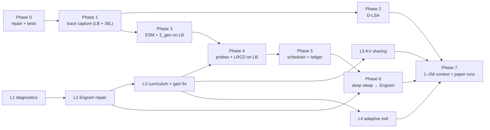

# 02 — Implementation Plan (Phases, Tasks, Interfaces, Acceptance Gates)

> Each phase ends with: `ast.parse` on all `.py`/`.ipynb` → GPU smoke run in Colab → acceptance gate → commit + push (`AGENTS.md` rule 4) → update the tracker in [`README.md`](README.md).
> **Base = 72L Loop Base (LB)**: frozen backbone + looped core + `TwoStreamMHC` (decision 2026-11-03, see `01 §0.4`, `01 C9`). Track M (memory) is implemented and evaluated **on LB**. Track L (loop / mHC / Engram repair) runs alongside, and **its L1–L3 must land before Track M Phase 4**, because memory targets are captured through the loop. 36L (same weights, loop off) is an ablation path only. Every interface must support both, via `loop_config()`.



---

## Phase 0 — Repair, Guardrails, Test Harness (Track M) · *est. 1–2 days*

**Goal:** the existing Stage 2 code either works correctly or is clearly marked experimental; we can trust every number it prints.

| Task | Detail | Files |
| :--- | :--- | :--- |
| 0.1 | Fix B1/B2: use `self.base.model.layers`; run the trace via a `loop_config()` context manager that saves/restores `(loop_start, loop_end, loop_passes, mhc_enabled, engram_enabled, enable_p3)` and calls `forward_hidden` | core |
| 0.2 | Fix B3 + M2 interim: use `out_proj`, apply `σ(g_proj(LN h))` per head | core |
| 0.3 | Fix B4: replace `evaluate_multi_domain_ppl` with [`evaluate_engram_perplexity_delta`](file:///storage/emulated/10/Documents/Spark_X2.6_Loop/sparkx_loop_v03_benchmarks.py#L1836); build episodes with [`encode_spark_chat_pair`](file:///storage/emulated/10/Documents/Spark_X2.6_Loop/sparkx_loop_v03_benchmarks.py#L1587) | benchmarks |
| 0.4 | Fix B5: hooks on `layer.self_attn` (pre-hook with kwargs → post-LN input) | core |
| 0.5 | Fix M5 (pseudo-inverse), M6 (never overwrite `project`), M4 truncation → raise `CapacityExhausted` | core |
| 0.6 | Fix m1: no `nn.Module.float()` calls in hot paths | core |
| 0.7 | `BackboneFingerprint`: SHA-256 + max-abs-diff vs snapshot | new `sparkx_memory_utils.py` |
| 0.8 | **Math unit tests** (pure torch, tiny dims, CPU-runnable in Colab): null-space orthogonality, ridge vs `torch.linalg.lstsq`, exact removal (`W + ΔW − ΔW == W`), shard capacity error | new `tests/test_memory_math.py` |
| 0.9 | Notebook: add `run_sleep_compiler_validation` toggle to Cell 2 (default `False`) | `.ipynb` (edit via JSON script, never `replace_file_content`) |

**Acceptance gate G0**
- All unit tests pass; backbone fingerprint identical before/after the (fixed) Stage D.
- Stage D runs end-to-end on a 4K-token episode and reports **non-zero** clusters per anchor.
- No change to Stage A–C outputs (diff a short run's metrics JSON).

---

## Phase 1 — Exact Trace Capture & Ablation Targets (Track M) · *est. 2–3 days*

**Goal:** reliable instrumentation for teacher/student residuals at any layer, in both the 36L and loop paths.

### Interfaces
```python
@contextmanager
def loop_config(model, *, start, end, passes, use_mhc, use_engram, enable_p3=False): ...

def capture_residuals(model, input_ids, layers: list[int], positions: torch.Tensor,
                      where: str = "post_block") -> dict[int, torch.Tensor]:
    """Returns {layer: [len(positions), 2560] fp32} residual stream after the decoder block
    (and after Engram if present). In the loop path keys are (layer, visit)."""

def capture_attention_io(model, input_ids, layers: list[int]) -> dict[int, dict]:
    """Per global layer: post-LN input, q/k/v (post-RoPE), gate g = sigmoid(g_proj(LN h)), out_proj weight."""

def block_ablation_delta(model, layer: int, h_in, kv_full, kv_minus) -> torch.Tensor:
    """δ = Block_ℓ(h | KV⁺) − Block_ℓ(h | KV⁻) for diagnostics (single-layer exactness check)."""
```

### Tests
- **Reconstruction test:** recompute `out_proj(g ⊙ SDPA(q,k,v))` from captured tensors → max rel. error vs the layer's actual attention output `< 1e-3` (bf16).
- **Hook parity:** residuals captured in 36L mode equal `forward_hidden` intermediate states.
- **mHC path:** hooks fire once per visit; count matches `execution_plan`.

**Gate G1:** reconstruction error < 1e-3; both paths covered by tests.

---

## Phase 2 — D-LSA Index on the RoPE-free Slice (Track M, parallelisable) · *est. 3–5 days*

### Tasks
1. `LatentSparseAttentionIndexer(rope_dim=64)`: index features from `k[..., 64:256]`; queries from the summed free slices.
2. `ward_bucketize(k_pool, max_bucket=16)`: mutual-nearest-neighbour Ward merges inside each 512-key block (vectorised; Tree variant optional).
3. `fit_dlsa_index(model, docs, steps=2000, lr=1e-3, seq_len=32768)`: trains only `w_q_idx`, `w_k_idx` with `KL(p_true_bucket ‖ softmax(score/τ))` + recall hinge. Backbone frozen; uses exact attention for teacher mass at 32K.
4. Hot/cold KV paging prototype (`ColdKVStore`): page size 4096, pinned host tensors, GPU-resident bucket centroids, async `index_select` copy of selected rows.

### Metrics
- Attention-mass recall@2048 per global layer at 32K / 64K / 128K.
- RULER-NIAH single/multi-key at 32K–128K: exact vs D-LSA.
- Prefill/decode latency per layer; host↔GPU bytes per decoded token.

**Gate G2:** mass recall@2048 ≥ 0.90 averaged over layers at 64K; RULER-NIAH within −2 pts of exact at ≤ 128K.

---

## Phase 3 — Episodic Side Memory Module & General Statistics (Track M) · *est. 3–4 days*

### Interfaces
```python
class EpisodicSideMemory(nn.Module):
    def __init__(self, width=2560, r=2048, route_dim=64, max_shards=64, gate_T=0.05): ...
    def forward(self, h: torch.Tensor) -> torch.Tensor:           # returns Δh, exactly 0 when empty
    def features(self, h, shard: int) -> torch.Tensor:            # φ_s(h) ∈ R^r (fp32)
    def gate(self, h, shard: int) -> torch.Tensor:                # g_s(h)
    def protected_basis(self, shard: int) -> torch.Tensor:        # U (r×k), general ∪ written keys
    def write(self, shard, A, Delta, alpha, centroids) -> WriteReport   # null-space ridge (01 §C5.2)
    def remove(self, delta_ref) -> None                           # exact subtraction
    def new_shard(self) -> int

def collect_esm_general_stats(model, tokenizer, n_tokens=3_000_000, energy=0.995) -> dict
def calibrate_esm_gate(model, canary_tokens, max_open_rate=1e-3) -> dict
```

### Integration points
- `SparkXLoopV03.__init__`: `self.esm = nn.ModuleDict(...)`, `self.esm_enabled = False`, `self.esm_layers = [3,7,11,15,19,23,27,31,35]`.
- [`forward_hidden`](file:///storage/emulated/10/Documents/Spark_X2.6_Loop/sparkx_loop_v03_core.py#L2926): add the ESM residual after prelude/coda layers in the list, and inside the loop on the **first visit** of each layer (`esm_visits="first"` default; `"all"` for the ablation). In mHC mode, read and write via the FFN read/write vectors (`01 C5.3`).
- `collect_esm_general_stats` runs **through LB** (mHC on), so Σ_gen covers the same features ESM sees at inference.
- Save/load: `esm_state.pt` + `esm_stats.pt` (Σ_gen eigvecs) independent of `loop_v03_state.pt`.

### Tests
- Empty ESM ⇒ logits bit-identical to model without ESM.
- Write then query: residual fit rel. error on written keys < 5%; `‖K_prot ΔW‖∞ < 1e-4`.
- Canary gate-open rate ≤ 0.1%; canary CE delta ≤ +0.5% after 100 random writes.

**Gate G3:** all tests pass on the real backbone (bf16 model, fp32 solves).

---

## Phase 4 — Self-Study Probes + LRCD Compiler (Track M) · *est. 1 week*

### Interfaces
```python
def generate_self_study_probes(model, tokenizer, span_ids, n_questions=16, n_paraphrases=2,
                               include_wake_queries=True, max_new_tokens=96) -> ProbeSet

def compile_span_lrcd(model, tokenizer, context_before_ids, span_ids, probes: ProbeSet,
                      layers=(3,7,11,15,19,23,27,31,35), eta=0.7, alpha=1e-2,
                      holdout_frac=0.25) -> CompileReport
    # 1) teacher residuals with span in context
    # 2) for ℓ in layers (ascending): student residuals with ESM active → δ → ESM.write
    # 3) verify on held-out probes: recovery ratio, KL, locality canaries
```

### Ablations wired in from day one
`keys ∈ {cluster-own h_b (Stage 2), real wake queries, self-study probes, both}` × `store ∈ {ESM, routed expert_down}` × `null-space ∈ {none, past-writes only, general+past}` × `layers ∈ {all 9, Engram 8, single best}` × `depth ∈ {LB (default), 36L-same-weights}` × `esm_visits ∈ {first (default), all}`.

**Gate G4 (on EFRE-small, `03 §D1`):** recovery ratio ≥ 0.6 on held-out probes for single-span episodes; locality canary ΔCE ≤ +0.5%; backbone fingerprint unchanged.

---

## Phase 5 — Sleep Scheduler, Ledger, Eviction, Rollback (Track M) · *est. 4–5 days*

### Interfaces
```python
class EpisodeBuffer: add_tokens(), spans(), stats(span_id)
def score_spans(model, buffer, weights) -> list[SpanScore]                # 01 §C2
class MemoryLedger: append(record), find(...), delta(ref), mark_removed(id)
class SleepScheduler:
    def __init__(self, model, tokenizer, ledger, kv_budget_tokens, idle_s=30): ...
    def on_tokens(self, ids): ...
    def maybe_sleep(self) -> SleepReport | None
    def run_light_sleep(self, budget_s: float) -> SleepReport
    def run_deep_sleep(self, budget_s: float) -> SleepReport              # Phase 6
    def forget(self, memory_id) -> None                                    # exact removal
```

**Gate G5:** streaming run over a 200K-token synthetic diary (EFRE-stream) keeps hot KV ≤ budget and retains ≥ 80% of the single-span recovery ratio after 50 sleep cycles; `forget()` restores pre-write logits on that span's probes (max-abs-diff < 1e-3).

---

## Phase 6 — Deep-Sleep Consolidation into Engram (Track M × L) · *est. 1 week*

- `consolidate_shards_smf(model, ledger, shard_ids, steps=300, top_t_experts=4, kl_general=0.5)`.
- Requires Track L gate GL2 (Engram not harmful) to be passed first.

**Gate G6:** after consolidation and shard removal, recovery ratio ≥ 0.8× the pre-consolidation value; general PPL ΔCE ≤ +1%; IFEval (541) within CI of before.

---

## Track L — Strengthen the Loop Base (alongside; L1–L3 block Phase 4) · *est. 2–3 weeks*

| Step | Task | Gate / target |
| :--- | :--- | :--- |
| L1 | Diagnostics: per-pass logit-lens CE, inter-pass KL, controller gain/grad/read-write-logit trajectories; per-anchor Engram ablation | report produced (`runs/L1/`) |
| L2 | Engram repair: zero-gate harmful anchors, prefill/decode gain parity, router health | **GL2:** `LB+Engram` PPL ≤ `LB` PPL on every domain (anchors failing it stay gate-zeroed) |
| L3 | Gain-collapse fix (softplus floor / scheduled gains / auto-alert) + recurrence curriculum (McLeish et al.): healing on general text → passes 1→2→2+P3, stochastic pass count per batch, LR restarts | **GL3 (target):** LB ≥ 36L-same-weights on PPL and within 95% CI on IFEval-541 / GSM8K at matched tokens |
| L4 | Adaptive exit (Ouro entropy-regularised gate or MoR router) | ≥ 25% FLOP saving at ≤ 0.5 pt quality loss |
| L5 | **Recursion-wise KV sharing** for global layers (required for 1–2M logical context on LB) | ≤ 1 pt RULER loss at 64K with 2× KV saving |

GL3 is a **repair target, not an exit**. If it is missed, LB stays the base, L1–L3 are iterated, and the paper reports the measured loop effect (Tier E, H-L1…H-L3 in `01 C9`). Track M Phase 4 may start once L3 has produced a stable checkpoint (no gain collapse, held-out CE not worse than the hub checkpoint), even if GL3 is not met yet.

---

## Phase 7 — Long Context + Paper Runs on LB · *est. 1 week*

- Enable the cold KV tier with L5 KV sharing on LB; run Tier C and EFRE-large at 1M / 2M logical tokens.
- Run the full `03` grid. Main rows are on **LB**; ablation rows are 36L-same-weights (loop off) and A-pristine. This includes the storage-vs-manipulation tests H-L2 / H-L3.
- Figures, release `esm_state.pt` + ledger format.

---

## Engineering Conventions

- **Dtypes:** backbone bf16; all solves, covariance stats and master copies of written weights in fp32.
- **Seeds:** every run logs `torch`, `numpy`, `random` seeds and the backbone fingerprint.
- **Logging:** JSONL per run in `runs/<date>_<phase>_<name>/metrics.jsonl` + `config.json`; summary row appended to `runs/index.csv`.
- **Notebook edits:** only via a Python script that loads/edits/saves the `.ipynb` JSON.
- **Commits:** one per task group, message prefix `phaseN(task):`; push immediately; update the tracker.
