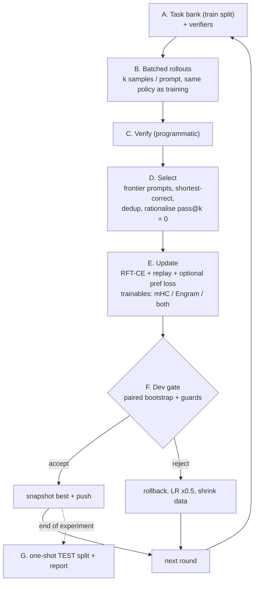

# 05 — SI-SRSI v2: Verified Self-Improvement with Held-Out Gating

> **Status:** design (nothing below is implemented yet). Supersedes the "simple" SI-SRSI loop (`run_si_srsi_engram_loop`, kept only for reproducibility).
> **Companion:** [06 — MoE-Engram Problem Analysis](06_ENGRAM_PROBLEM_ANALYSIS.md) (what SI-SRSI v2 can and cannot fix).
> **Claims policy:** `00 §5` applies — no "exact" / "zero" / "improves capability" without a measurement on a split the training never touched.

---

## 0. Purpose and non-goals

**Purpose.** Measurably improve the 72L Loop Base + MoE-Engram on **verifiable** tasks (math, code, instruction-following, tool-calls, closed-book facts) using the model's own samples, filtered by programmatic verifiers, with every update gated on held-out evidence.

**Non-goals.**
- Not a replacement for the 20 h long run (`sparkx_long_run.py`), which supplies *unique-token pre-adaptation* of Engram + mHC. SI-SRSI v2 runs **after** it.
- Not a style/"anti-slop" optimiser. Style detectors become *guards* (non-regression), never the objective.
- Not a claim that a frozen-backbone model can gain broad new reasoning ability. The trainable surface is only the 24 mHC controllers + MoE-Engram (≈3.5 B trainable params, nearly all in the sparse Engram lookup/expert bank); realistic gains are listed in §9.

---

## 1. Audit of SI-SRSI v1 (verified in code, `sparkx_loop_v03_benchmarks.py`)

| # | Finding | Evidence | Consequence |
| :-- | :-- | :-- | :-- |
| A1 | **Train set = eval set.** 5 curriculum tasks (`_build_si_srsi_curriculum_tasks`: 2 anti-slop, 1 web-UX/sec, 2 STEM) are both trained on and used for the reported rubric (72.4 → 96). | L3197, L3522, L3598, L3727 | The headline rubric gain is memorisation of 5 prompts, not generalisation. |
| A2 | **"Teacher" is a static answer key.** Without a working API the supervisor returns the hand-written `task["teacher_instructed_target"]` (`teacher_source="opencode_verified_curriculum_supervisor"`). The OpenCode endpoint returned 0/120 verified items in the production run. | L3406–3449 | No diagnosis, no new information, SFT on 5 fixed strings. |
| A3 | **Heuristic regex rubrics** (`score_anti_slop_composition`, `score_web_ux_and_defensive_security`, `score_stem_knowledge_and_reasoning`) are the accept signal. | L3453–3459, L2956 | Classic Goodhart target; one can raise the score without raising quality. |
| A4 | **Leaked general anchors / PPL gate.** General replay and the PPL gate use `_HELD_OUT_EVAL_TEXTS`, which the same function trains on. | L3623, L3749 | "Held-out PPL 7.18 → 1.48" is not held-out. |
| A5 | **Rollout/training Engram mismatch.** Rollouts use `set_engram_flight_mode("deep_knowledge")` (Top-16, 5-gram) while training forward uses the stage's `active_top_k` (Top-7). | L3512, L3724 vs train loop | The policy that is sampled is not the policy that is optimised. |
| A6 | **Tiny update budget.** 2 rounds × ~32 steps, sequences ≤ 1.5–2 K tokens, effective expert LR clamped to 1.8e-5, `expert_gate/up` frozen. | L3635–3638, L3580 | Little room for anything but memorising the 5 targets. |
| A7 | **FTPO unlikelihood is probably near-inert** (hypothesis, unmeasured). It penalises the *first token* of banned phrases, on the last ≤128 teacher-forced positions of a target that rarely contains them. | L3609–3614, L3705–3711 | Gradient ≈ 0 on most steps; or, if non-zero, a crude first-token ban with side effects. |
| A8 | **No statistical test, no confidence interval, n = 5.** | — | Cannot distinguish improvement from noise. |

**Conclusion:** v1 cannot support a capability claim. It is not "weak but valid"; its numbers are uninformative.

---

## 2. Design principles

1. **Split integrity.** Train / dev / test are disjoint *by prompt hash* (`sha1(prompt) % 100`: 0–79 train, 80–89 dev, 90–99 test). The test split is touched **once**, at the very end of each experiment. Same hash discipline as the long run (`is_val_doc`).
2. **Verifier-first rewards.** A sample is "good" only if a *programmatic* verifier says so (numeric answer, unit tests, constraint checkers, JSON-schema + mock-tool execution, exact-match with aliases). Judge-model or regex-rubric scores may *rank among already-verified samples*, never admit unverified ones.
3. **On-policy + filtered (RFT / ReST-EM / STaR style).** Train on the model's own verified samples (low surprise → low interference with the frozen backbone), plus *rationalised* samples for pass-rate-0 prompts (answer given as hint, rationale regenerated, **re-verified without the hint**).
4. **Same policy for rollout and update.** Sampling and training forward use the identical loop config and Engram top-k (fixes A5). Flight-mode expansion is evaluated separately as an *inference-time* ablation.
5. **Trust region + locality.** Every round mixes replay from the long-run stream (unique, non-leaked), caps per-round LR, and is rolled back unless non-inferiority guards hold.
6. **Statistical gating.** Accept a round only if the paired-bootstrap 95 % CI on the primary dev metric has lower bound ≥ 0 **and** every guard metric is non-inferior within its margin (§6). Otherwise roll back, halve LR, shrink data.
7. **Attribution by ablation.** Every claimed gain is decomposed (mHC-only / Engram-only / both / matched-token unverified-sample control) so "more training" is not mistaken for "better method".
8. **Every round checkpointed and resumable** (same Hub-persistence scheme as the long run).

---

## 3. Pipeline (one round)



### A. Task bank and verifiers (`sparkx_si/verifiers.py`, `taskbank.py`)

| Pillar | Source | Verifier | Notes |
| :-- | :-- | :-- | :-- |
| Math | Numina-1.5 / Big-Math / GSM8K-style items with a final numeric/symbolic answer | normalised final-answer match (reuse `_extract_gsm8k_decimal`; add `\boxed{}` + fraction/units normalisation, SymPy equivalence with timeout) | Drop items whose answer cannot be machine-checked. |
| Code | open-r1 `verifiable-coding-problems`, MBPP-style items with tests (v1 curation accepted **0** of these; field mapping must be fixed first) | sandboxed execution: subprocess, no network, CPU/memory/time rlimits, temp dir | **Security gate:** code is model-generated; run only in the ephemeral Colab VM, never with credentials in env. |
| Instruction following | **Synthetic**: composable constraints (word/sentence counts, forbidden/required words, JSON/markdown structure, casing, ending phrase, N bullets, language) | one deterministic checker per constraint (IFEval/IFBench-style); strict + loose | No dataset dependency; infinite prompts; train/dev/test by prompt hash. |
| Tool / agent | schema-bearing prompts (functions with JSON schema) | JSON parse → schema validation → execute against mock tool → compare result | Tests format fidelity and argument correctness. |
| Closed-book facts (Engram track) | free-form QA items with short verified answers (alias list) | normalised exact-match / alias match | Used for **gap mining** (§5), not for generic RFT. |
| Style (guard only) | existing detectors (`score_anti_slop_composition`, slop-phrase rate, sentence-length burstiness) | rates, not scores | Non-regression guard; reported, never optimised alone. |

Each verifier has unit tests with positive, negative and adversarial cases (e.g. answer appearing only in the prompt, `\boxed` inside the think block, code that prints expected output without computing it).

### B. Rollout engine (`sparkx_si/rollout.py`)

- **Batched** generation (left-padded batches, KV cache), `k = 8` samples per prompt, `T = 0.8`, `top_p = 0.95`, think budget capped at 2 048, answer cap at 1 024.
- Identical loop config and Engram top-k as the trainer; the chosen setting is recorded in the round log.
- **Throughput is unmeasured** for the 72L custom loop. Gate SI0 measures tokens/s at batch 1/8/32; round size is derived from it (a round of 2 000 prompts × 8 samples × ~1.5 K tokens ≈ 24 M generated tokens, which is only feasible if batched throughput is several K tok/s).
- Records per sample: prompt id, text, token logprobs of sampled tokens, verifier result, length, wall time.

### C/D. Selection (`sparkx_si/select.py`)

1. Per prompt compute pass rate `p̂ = c/k`.
2. **Frontier set:** prompts with `0 < p̂ < 1` (learnable signal). `p̂ = 1` prompts contribute ≤ 10 % (anti-collapse replay of already-solved behaviour); `p̂ = 0` go to rationalisation.
3. From each frontier prompt keep up to 2 correct samples: prefer **shortest correct** (length-penalised) and majority-consistent final answers.
4. **Rationalisation** (STaR): for `p̂ = 0` prompts with a gold answer, regenerate with the answer as a hint, strip the hint, **re-verify the rationale without the hint**, keep only if it passes; tag `rationalized=true` (reported separately; ablated).
5. Dedup by prompt key and by n-gram overlap of the response; cap per-pillar share (default max 35 % per pillar) so one pillar cannot dominate.
6. Diversity check: distinct-4-gram ratio of the kept set must be ≥ 0.9 × that of the raw samples, else resample.

### E. Update (`sparkx_si/update.py`)

- **Loss:** `CE(selected responses)` with prompt masking (same masking as `tokenize_and_mask_record_16k`) **+** replay `CE` on long-run stream tokens (default 1:1 token ratio) **+** optional pairwise term (phase SI5): `ORPO`/`DPO`-style on (verified-correct, verified-wrong) pairs from the *same prompt*, reference logprobs stored at rollout time (avoids a second forward through a reference model).
- **Trainable sets (ablation arms):** `mHC-only`, `Engram-only` (no controller update), `both`. Backbone always frozen (`BB_LR_Mult = 0`).
- **Trust region:** LR ≤ the long run's final LR; per-round grad-norm clip 1.0; replay ratio ≥ 0.5; optional KL-to-snapshot penalty on replay tokens (`β = 0.02`) if the guard CE drifts.
- **Unlikelihood on slop:** removed as a training signal; replaced by the style *guard* (A7).
- **Engram dropout (hypothesis H-E2, see doc 06):** with prob `p_drop` per step, ablate a random anchor subset via the existing `engram_ablation` hooks so no anchor can rely on a harmful partner; evaluated as an arm, not assumed.

### F. Gate (`sparkx_si/gate.py`) — see §6.

### G. Final test (`sparkx_si/report.py`)

One-shot evaluation on the untouched test split, per-pillar and overall, with CIs, plus the attribution table.

---

## 4. Evaluation battery (frozen before any training)

| Suite | Split use | n | Metric | Smallest detectable effect* |
| :-- | :-- | :-- | :-- | :-- |
| Math (GSM8K-style + MATH-lite) | dev + test | ≥ 500 each | pass@1 (greedy) and maj@8 | ≈ 4–5 pts |
| Code (HumanEval + MBPP, execution) | test (+ dev from open-r1 tests) | ≥ 500 | pass@1 | ≈ 5 pts (n≈500) |
| IFEval-541 (real) + synthetic IF dev | test / dev | 541 / ≥ 500 | strict & loose prompt-level | ≈ 4 pts |
| Closed-book QA | dev + test | ≥ 300 each | EM/alias | ≈ 5 pts |
| Long-run held-out CE (frozen 64-doc set + 5-text set) | guard | ~190 K tokens | CE ON/OFF, per pillar | 0.01–0.02 nats |
| Style guard | guard | ≥ 200 prompts | slop-phrase rate, burstiness | report only |

\*Rough binomial standard errors (`√(p(1−p)/n)` ≈ 2.2 pts at n = 500); paired bootstrap on identical prompts is tighter than unpaired, but treat anything below the stated effect as noise. **n = 5 results are never reported as evidence.**

**Contamination caveat.** The base `Spark-X2.6-4B` post-training data is unknown; public test sets may be contaminated. We report absolute scores *and* deltas, and prefer synthetic/hash-split suites for decisions.

**Configurations compared at SI0 (no training):** `A-pristine 36L`, `72L Engram OFF`, `72L + Engram (current Hub model)`, `72L + Engram (after long run)`.

---

## 5. Engram-specific track: "does the vertical store store?"

SI-SRSI's generic RFT mostly adapts *behaviour*. The thesis "vertical memory supplies knowledge storage" needs a dedicated, falsifiable test:

1. **Gap mining.** Run closed-book QA with the pre-write model; items with `p̂ = 0` over `k = 8` and a verified alias set form the **gap set** `G` (facts the backbone does not know). Split `G` by fact id into `G_write` (80 %) and `G_test` (20 %).
2. **Write.** Train **Engram parameters only** (mHC frozen) on `G_write` statements in ≥ 4 surface forms each (templated + model-generated paraphrases, deduped), with replay.
3. **Evaluate (all three required):**
   - *Recall:* held-out **paraphrased questions** of written facts (not the exact write phrasing) — EM gain over pre-write.
   - *Generalisation boundary:* `G_test` facts (never written) — must **not** change (else the effect is leakage or general drift).
   - *Locality:* accuracy on a disjoint set the model already knew, and held-out CE — drop ≤ 0.5 pts / ≤ 0.01 nats.
4. **Success criterion:** paraphrase-EM gain ≥ 15 pts with CI excluding 0 **and** locality satisfied. Failure is a publishable negative result about the Engram design, and routes to doc 06's architectural fixes.

This replaces the v1 "transfer ratio" diagnostic, which was an artifact of teacher forcing (see `README` row *Engram generalization diagnostic*).

---

## 6. Gate definition

Let `Δ_m` be the paired difference (candidate − incumbent) on metric `m` over dev prompts, with paired bootstrap (10 000 resamples) 95 % CI.

| Metric | Role | Accept rule |
| :-- | :-- | :-- |
| Mean of per-pillar dev pass@1 (math, code, IF, tools) | primary | CI lower bound ≥ 0 **and** point estimate ≥ +1.0 pt |
| Each pillar individually | guard | `Δ ≥ −2.0 pts` (point estimate) |
| Closed-book QA dev | guard | `Δ ≥ −1.0 pt` |
| Long-run held-out CE (ON) | guard | `Δ ≤ +0.01 nats` |
| Engram `ce_on − ce_off` | guard | must not increase by > 0.01 |
| Style (slop rate, burstiness) | guard | no worsening beyond report-level thresholds |
| Diversity (distinct-4) of samples | guard | ≥ 0.9 × incumbent |

Reject ⇒ restore snapshot, `lr ×= 0.5`, halve selected-set size, log reason. Two consecutive rejects ⇒ stop and report. The test split is never used by the gate.

---

## 7. Milestones and acceptance gates

| ID | Milestone | Depends on | Acceptance | Effort |
| :-- | :-- | :-- | :-- | :-- |
| **SI0** | Baseline battery on 4 configs (§4) + generation throughput at batch 1/8/32 + frozen splits committed | long run best ckpt (can start on current Hub model) | numbers + CIs recorded; throughput known; round size derived | S |
| **SI1** | Verifier library + task bank + sandbox, pure-Python unit tests | — | ≥ 95 % verifier test pass incl. adversarial cases; code sandbox blocks network/file escape tests | M |
| **SI2** | Batched rollout engine (policy-consistent) | SI0 | sampled vs teacher-forced logprob mismatch < 1e-3 nats/token on 50 samples (proves same policy) | M |
| **SI3** | RFT round with gate; arms: mHC-only / Engram-only / both / matched-token unverified control | SI1, SI2 | ≥ 1 accepted round **or** a clean negative with CIs | M |
| **SI4** | Engram gap-write test (§5) | SI0, SI1 | §5 success criterion met, or negative result documented | M |
| **SI5** | Optional pair-preference term | SI3 | gate-accepted gain over SI3 best | S |
| **SI6** | Multi-round run with replay, snapshots, Hub persistence | SI3 | ≥ 3 rounds, no guard violation in accepted rounds | L |
| **SI7** | One-shot test report + attribution table + claims update | SI6 | report committed; roadmap claims re-derived | S |

Suggested order: **long run → SI0 → SI1 → SI2 → SI3 → SI4 → SI6 → SI7** (SI0/SI1 can proceed in parallel with the long run because they only need the CPU and the current checkpoint).

---

## 8. Compute budget (all unmeasured until SI0)

- Rollout dominates. Budget per round ≈ `prompts × k × avg_tokens / batched_tok_s`. Example with 2 000 prompts, k = 8, 1.5 K tokens, 4 K tok/s ⇒ ≈ 1.7 h/round; with 1 K tok/s ⇒ 6.7 h/round (then shrink to ~500 prompts).
- Update ≈ 0.3–0.5 h/round (tens of steps at 131 K tok/step).
- Eval battery ≈ 20–40 min (greedy, ~2.5 K prompts).
- Total for 3 rounds ≈ 8–20 h depending on SI0 throughput — plan as separate Colab sessions with the same resume scheme as the long run.

## 9. Expected outcomes (calibrated)

- **Likely:** better *consistency* — maj@8 → pass@1 distillation, constraint adherence, tool-call format fidelity; a few points on in-distribution dev suites.
- **Possible:** small gains on held-out public suites; improved Engram `ce_on − ce_off` if on-policy data reduces its memorisation pressure (measured, not assumed).
- **Unlikely:** new reasoning capability beyond the frozen backbone's; large gains on benchmarks far from the task bank.
- **Real risk:** Goodharting on synthetic IF constraints (mitigated by real IFEval-541 test), reward hacking in code sandbox tests, diversity collapse (guarded), and gains that vanish after the paired control arm.

## 10. Module layout and configuration (planned)

```
sparkx_si/
  verifiers.py   # math / code(sandbox) / IF constraints / tool-schema / QA-alias checkers
  taskbank.py    # hash-split task construction, synthetic IF generator, gap mining
  rollout.py     # batched sampling, logprob capture, policy-consistency check
  select.py      # frontier selection, rationalisation, dedup, diversity
  update.py      # RFT + replay (+ pref), arm selection, trust region
  gate.py        # paired bootstrap, guards, rollback decisions
  report.py      # per-pillar tables, attribution, one-shot test
tests/test_si_*.py   # pure-Python (verifiers, hashing, selection, bootstrap, gate policy)
```

Config keys (`SI_*`): `SI_K=8`, `SI_TEMP=0.8`, `SI_PROMPTS_PER_ROUND`, `SI_REPLAY_RATIO=0.5`, `SI_ARMS`, `SI_GATE_MIN_GAIN=1.0`, `SI_PILLAR_CAP=0.35`, `SI_SPLIT_MOD=100`, `SI_ENGRAM_DROPOUT=0.0`.

## 11. Disposition of v1

`run_si_srsi_engram_loop` and `run_phase4_engram_consolidation` stay in the repo for reproducibility but are **off by default** (`ENABLE_PHASE4_POST_TRAIN=False`, `ENABLE_SI_SRSI_ENGRAM_LOOP=False` in the long-run notebook). Their reported numbers are annotated as leaked in the roadmap.
