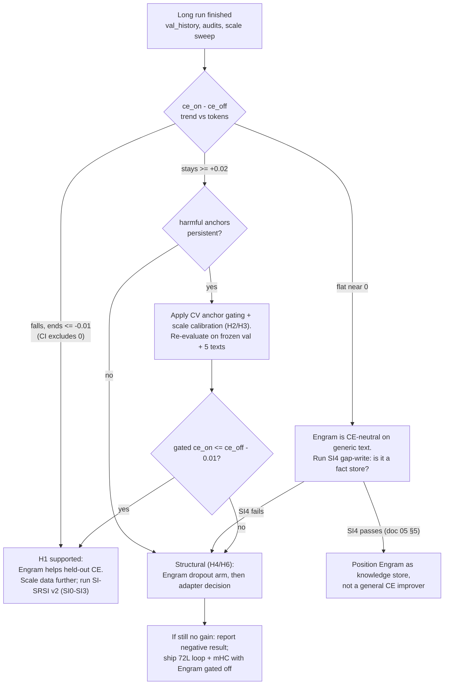

# 06 — MoE-Engram Problem Analysis, Hypotheses and Decision Tree

> **Status:** analysis + test plan. Companion to [05 — SI-SRSI v2](05_SI_SRSI_V2_DESIGN.md) and to the 20 h long run (`sparkx_long_run.py`).
> **Claims policy:** `00 §5`. Items marked *hypothesis* have **not** been measured.

---

## 1. Verified symptoms (all leak-free, Colab, 2026-11-03/04)

| # | Observation | Source |
| :-- | :-- | :-- |
| S1 | On 5 hand-written held-out texts (1 330 tokens): Engram OFF CE **1.5090**, FULL **1.5750** (+0.066; PPL 4.52 → 4.83). Engram hurts 5/5 texts; CE is monotone worse in Engram scale (best scale 0). | Cell 9 |
| S2 | Leave-one-anchor-out: removing **L31 alone** → CE 1.4982 (< OFF). Other anchors within ±0.005. | Cell 9 |
| S3 | Cross-validated gating of `{7, 11, 23, 31}`: OFF 1.5090 / FULL 1.5750 / GATED 1.4901 (−0.0188 vs OFF). Both folds chose the same anchors. Low power (5 texts, 2 folds). | Cell 10 |
| S4 | Lexical hypothesis refuted: `LEX_ONLY` gain ≈ 0, `SEM_ONLY` ≈ `FULL`. Tier-1 tables are zero-init and trained at LR ≤ 1.8e-5. | Cell 8 |
| S5 | Marginal Engram gain on the *trained* prompts is only 0.013–0.037 nats; "transfer 3–9×" was a teacher-forcing artifact. | Cell 8/9 |
| S6 | Training regime that produced these weights: ~5.08 M packed tokens seen ≈ **3.9 epochs**, train CE 0.78 → 0.35 while held-out CE ≈ 1.5; no validation split; "best" chosen on leaked texts. | Cell 4 audit |

Not yet measured: the loop's own benefit on *true* held-out text (the often-quoted 36L 7.14 → 72L 1.59 PPL is on leaked texts and must not be cited); any downstream capability benchmark.

---

## 2. Hypotheses, predictions, tests

| ID | Hypothesis | Prediction if true | Test (where) | Fix if true |
| :-- | :-- | :-- | :-- | :-- |
| **H1** | **Data starvation / memorisation.** ~4 B Engram parameters were fit to ~5 M tokens for ~4 epochs, so they store training text instead of generalisable structure. | Held-out `ce_on − ce_off` falls with *unique* tokens; train–val gap shrinks; per-pillar deltas move together. | 20 h long run `val_history` (`ce_on`, `ce_off`, per pillar every 40 steps). | Keep scaling unique data; dedup; continue. |
| **H2** | **Harmful anchors**, esp. `L31` (coda anchor immediately before the logits, so nothing downstream can correct it). | Same anchors show negative `removal_delta_ce` in ≥ 3 consecutive audits. | Audit every 4th eval in the long run (`removal_delta_ce`, `harmful_anchors`). | Post-hoc CV gating on the 64-doc set (never gain = −30 *before* training: dead gradients); optionally smaller init gain for the last anchor. |
| **H3** | **Scale/gain miscalibration.** The learned function has net harm on unseen text at the trained scale. | CE-vs-scale sweep still monotone worse after the long run. | `engram_utility_report` in notebook Cell 4 (post-run). | Held-out-calibrated global scale; per-anchor scale learned on val; scale ∈ [0, 1] stored in state dict. |
| **H4** | **Objective mismatch.** CE on instruction trajectories mostly teaches response style; Engram memorises long-tail response text (S5). | `ce_off` improves but `ce_on − ce_off` stays ≥ 0; SI4 gap-write recall low. | Long run + SI4 (doc 05 §5). | Engram dropout (random anchor ablation per step); weight decay on experts; surprise-gated writes; train Engram on *knowledge-gap* data rather than generic trajectories. |
| **H5** | **Routing collapse / under-use** of the 32 experts. | `router_load_cv` high, few experts carry mass. | `get_engram_routing_telemetry` already logged in Stage logs; add to long-run eval. | Balance-step tuning (`ENG_BALANCE_STEP_SIZE`), z-loss weight. |
| **H6** | **Frozen consumer.** The frozen backbone never learned to consume Engram residuals; only 24 mHC controllers co-adapt. | Gains saturate at a floor regardless of data. | Compare mHC-only vs Engram-only vs both arms (SI3). | *Decision for owner, not assumed:* a tiny trainable adapter on the post-anchor path (violates the pure frozen-backbone rule). |

H1 and H4 are the leading explanations given S4–S6; none is proven.

---

## 3. What the 20 h long run can and cannot do

**Can:** test H1 directly (unique tokens, leak-free validation, per-pillar), expose H2/H3/H5 trends every 40 steps, select the best held-out checkpoint and roll back plateaus. The baseline is the **current Hub model**, so `val_history[0]` is the starting point and every later row is a paired improvement/regression against it.

**Cannot:** guarantee an Engram benefit. ~85 M tokens against ~4 B parameters is still data-starved; if H4/H6 dominate, more generic data will not help.

**Caveat:** the starting weights are already overfit (S6); recovery may be slower than training from reset. A fresh-start arm costs another multi-hour run and is not planned unless the long run shows H1 is partially true.

---

## 4. Decision tree after the long run

**Definition of "Engram problem solved"** (all required): held-out `ce_on ≤ ce_off − 0.01` with a paired-bootstrap 95 % CI over the frozen 64-doc set; **no** harmful anchor in 3 consecutive audits; SI4 gap-write criterion met. Anything weaker is reported as partial.

---

## 5. Will SI-SRSI v2 fix the Engram problems? Will it raise capability?

- **Engram CE harm:** **not by itself.** SI-SRSI v2 trains on verified on-policy samples; it does not change the Engram architecture or add unique-token pressure. It can *indirectly* help (on-policy text is low-surprise, so less to memorise; Engram dropout arm; replay keeps the long-run gains) — that is hypothesis H4, to be measured by the `mHC-only / Engram-only / both / matched-token control` arms.
- **Engram as a storage mechanism:** SI-SRSI v2's **gap-write track (SI4)** is the first experiment that can actually demonstrate or refute the "vertical memory stores knowledge" thesis, because it measures paraphrase recall of facts the backbone did not know, with locality controls.
- **Capability:** expect *consistency* gains (maj@k → pass@1, constraint and tool-format adherence) on the task-bank pillars, a few points on dev suites, possibly small gains on held-out public suites. The frozen backbone caps what can be learned; no claim of new reasoning ability is made. Every number will carry a CI and a control arm; "no significant gain" is an acceptable, reportable outcome.

## 6. Roadmap hooks

| Milestone | Where |
| :-- | :-- |
| Long run → decision tree (§4) | tracker row *20 h resumable long run* |
| SI0–SI7 | [05 §7](05_SI_SRSI_V2_DESIGN.md) |
| Capability baseline incl. loop-vs-36L on **true** held-out text | SI0 |
