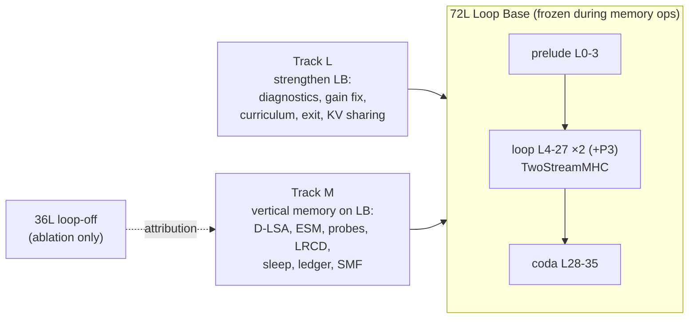

# Spark-X2.6 Recursion — Roadmap (Source of Truth)

> **Base architecture: the 72L Loop Base (LB).** The frozen `XHToken/Spark-X2.6-4B` backbone runs as prelude `L0–3` → looped core `L4–27` × 2 (+ optional P3 over `L12–23`), mixed by 24 `TwoStreamMHC` controllers → coda `L28–35`.
> On top of LB we build **vertical long-term memory**: Episodic Side Memory (ESM) written during sleep by closed-form null-space writes, and consolidated into MoE-Engram. The horizontal window stays working attention (hot KV + D-LSA cold tier).
> Thesis: **the loop manipulates, the vertical memory stores.**

## Documents

| # | Document | Contents |
| :--- | :--- | :--- |
| 00 | [Review & Verified Facts](00_REVIEW_AND_VERIFIED_FACTS.md) | Verified backbone facts (partial RoPE, `g_proj`, `out_proj`, anchors), KV arithmetic, Stage 2 review (B1–B5, M1–M9), citation cross-check, claims policy |
| 01 | [Architecture Design](01_ARCHITECTURE_DESIGN.md) | Principles, system diagram, memory hierarchy, components C0–C9: **why / how / implement & integrate / refinement** |
| 02 | [Implementation Plan](02_IMPLEMENTATION_PLAN.md) | Phases 0–7, Track L1–L5, dependency graph, interfaces, tests, acceptance gates |
| 03 | [Training & Evaluation](03_TRAINING_AND_EVALUATION.md) | Config grid (LB0/LB1/A36/A-pristine), statistics, Tiers A–E, EFRE benchmark, training runs T0–T5, claim → evidence map |
| 04 | [Verified References](04_REFERENCES_VERIFIED.md) | 30 references, all web-verified on 2026-11-03, with what each is used for and where |

## Status Legend
`⬜ todo` · `🟨 in progress` · `🟩 gate passed` · `🟥 blocked / failed gate` · `⏸ deferred`

## Milestone Tracker

| Milestone | Track | Depends on | Gate | Status | Commit / run |
| :--- | :--- | :--- | :--- | :--- | :--- |
| Stage 1 research synthesis (`AGENTS.md`) | — | — | — | 🟩 | `0c07b3a` |
| Stage 2 sleep compiler prototype | M | — | — | 🟥 non-runnable (B1–B5) | `47a7cc6` |
| Review hotfix: Stage D opt-in, citations | M | — | — | 🟩 | `b841a3e` |
| Roadmap 00–04 + LB-as-base decision | — | — | — | 🟩 | `c1b6d09` |
| **Phase 0** repair, guardrails, math tests | M | — | G0 | 🟨 (0.3 guard landed via opt-in) | `b841a3e` |
| **L1** loop / mHC / Engram diagnostics | L | — | report | ⬜ | |
| **L2** Engram repair | L | L1 | GL2 | ⬜ | |
| **L3** gain-collapse fix + healing + recurrence curriculum | L | L1 | stable ckpt (GL3 target) | ⬜ | |
| **Phase 1** trace capture (LB + 36L, gapped position ids) | M | P0 | G1 | ⬜ | |
| **Phase 2** D-LSA on RoPE-free slice | M | P1 | G2 | ⬜ | |
| **Phase 3** ESM module + Σ_gen through LB | M | P1 | G3 | ⬜ | |
| **Phase 4** self-study probes + LRCD on LB | M | P3, **L3** | G4 | ⬜ | |
| **Phase 5** sleep scheduler, ledger, eviction, forget | M | P4 | G5 | ⬜ | |
| **Phase 6** deep-sleep SMF consolidation into Engram | M×L | P5, L2 | G6 | ⬜ | |
| **L4** adaptive exit | L | L3 | ≥25% FLOP saving | ⬜ | |
| **L5** recursion-wise KV sharing (required for 1–2M on LB) | L | L3 | ≤1 pt RULER @64K | ⬜ | |
| **Phase 7** 1–2M context + paper grid (incl. H-L2/H-L3) | M×L | P2, P6, L4, L5 | claims 1–8 | ⬜ | |

## Two Tracks, One Base

- **Track L** makes LB healthy, and is a prerequisite for Track M Phase 4.
- **Track M** builds memory on LB.
- The 36L configuration exists only to attribute effects to the loop (`03 §1`).

## Immediate Next Actions
1. **Phase 0** (`02`): fix B1–B5 / M5 / M6, add `BackboneFingerprint` (covers backbone + mHC), add CPU math tests (`tests/test_memory_math.py`).
2. **L1** in parallel (Colab): per-pass logit lens, gain/grad trajectories, per-anchor Engram ablation on the hub checkpoint. Use **IFEval-541**, not n=50.
3. Decide **LB-blend vs LB-pristine** (`01 C0`). The default is LB-blend plus an A-pristine ablation.

## Working Rules
- Update this tracker whenever a milestone changes state (`AGENTS.md` rule 5). Every row gets a commit hash or run id.
- Commit and push per stage after `ast.parse` checks (`AGENTS.md` rule 4).
- Follow the claims policy in `00 §5`. No "exact" or "zero" without a measurement.
- No Replica identity-dimension work in this repo (`AGENTS.md` rule 3).
