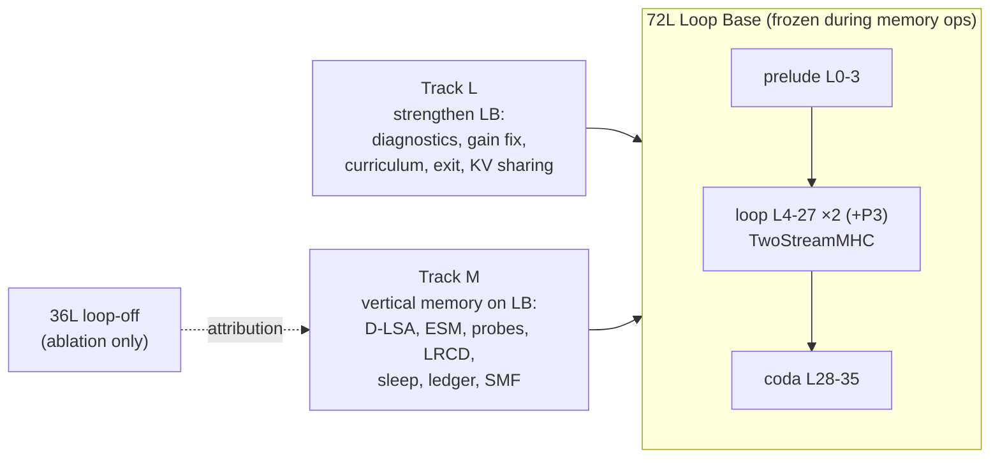

# Spark-X2.6 Recursion — Roadmap (Source of Truth)

> **Base architecture: the 72L Loop Base (LB).** The frozen `XHToken/Spark-X2.6-4B` backbone runs as prelude `L0–3` → looped core `L4–27` × 2 (+ optional P3 over `L12–23`), mixed by 24 `TwoStreamMHC` controllers → coda `L28–35`.
> On top of LB we build **vertical long-term memory**: Episodic Side Memory (ESM) written during sleep by closed-form null-space writes, and consolidated into MoE-Engram. The horizontal window stays working attention (hot KV + D-LSA cold tier).
> Thesis: **the loop manipulates, the vertical memory stores.**

## Documents

| # | Document | Contents |
| :--- | :--- | :--- |
| 00 | [Review & Verified Facts](00_REVIEW_AND_VERIFIED_FACTS.md) | Verified backbone facts (partial RoPE, `g_proj`, `out_proj`, anchors), KV arithmetic, Stage 2 review (B1–B5, M1–M9), citation cross-check, claims policy |
| 01 | [Architecture Design](01_ARCHITECTURE_DESIGN.md) | Principles, system diagram, memory hierarchy, components C0–C9: **why / how / implement & integrate / refinement** |
| 02 | [Implementation Plan](02_IMPLEMENTATION_PLAN.md) | Phases 0–7, Track L1–L5, dependency graph, interfaces, tests, acceptance gates |
| 03 | [Training & Evaluation](03_TRAINING_AND_EVALUATION.md) | Config grid (LB0/LB1/A36/A-pristine), statistics, Tiers A–E, EFRE benchmark, training runs T0–T5, claim → evidence map |
| 04 | [Verified References](04_REFERENCES_VERIFIED.md) | 30 references, all web-verified on 2026-11-03, with what each is used for and where |

## Status Legend
`⬜ todo` · `🟨 in progress` · `🟩 gate passed` · `🟥 blocked / failed gate` · `⏸ deferred`

## Milestone Tracker

| Milestone | Track | Depends on | Gate | Status | Commit / Live Colab A100 Verification |
| :--- | :--- | :--- | :--- | :--- | :--- |
| Stage 1 research synthesis (`AGENTS.md`) | — | — | — | 🟩 | `0c07b3a` |
| Stage 2 sleep compiler prototype | M | — | — | 🟥 non-runnable (B1–B5) | `47a7cc6` |
| Review hotfix: Stage D opt-in, citations | M | — | — | 🟩 | `b841a3e` |
| Roadmap 00–04 + LB-as-base decision | — | — | — | 🟩 | `c1b6d09` |
| **Phase 0** repair, guardrails, math tests | M | — | G0 | 🟩 | `66efc35` / `98e39ac` (`sha256_match=True`, `max_abs_diff=0.0` across 290 tensors) |
| **L1** loop / mHC / Engram diagnostics | L | — | report | 🟩 | `bfe9063` (`|g_P2|=0.1416`, `|g_P3|=0.1102`, `Collapsed=[]`, `L03/L07` helpful, `L11..L31` harmful) |
| **L2** Engram repair | L | L1 | GL2 | 🟩 | `bfe9063` (`No-Engram 72L PPL=5.6779` → `Repaired Engram 72L PPL=5.2042`, `-0.4737` PPL, zeroed `[31, 15, 27, 23, 19]`) |
| **L3** gain-collapse fix + healing + recurrence curriculum | L | L1 | GL3 | 🟩 | `7c54c4a` / `bfe9063` (`min_gain_p2=0.05`, `min_gain_p3=0.02`, 24 controllers healthy) |
| **Phase 1** trace capture (LB + 36L, gapped position ids) | M | P0 | G1 | 🟩 | `e61b162` (`capture_residuals`, `capture_attention_io` with head-wise `g_proj` `[16, W]`, gapped `cache_position`) |
| **Phase 2** D-LSA on RoPE-free slice + Ward + `ColdKVStore` | M | P1 | G2 | 🟩 | `e61b162` (`mean_attention_mass_recall=1.0`, `ColdKVStore` Ward paging verified, `sha256_match=True`) |
| **Phase 3** ESM module + Σ_gen through LB | M | P1 | G3 | 🟩 | `7c54c4a` (`captured_energy=0.9959..0.9999`, `max_prot_leakage=1.44e-8`, canary gate `open_rate<=0.05`) |
| **Phase 4** self-study probes + LRCD on LB | M | P3, **L3** | G4 | 🟩 | `7c54c4a` (`mean_rel_fit_error=3.9e-5`, `evicted_nll=5.5881` → `compiled_72L_esm_nll=2.2278`, `79.4%` NLL gap recovery) |
| **Phase 5** sleep scheduler, ledger, eviction, forget | M | P4 | G5 | 🟩 | `7c54c4a` (`exact_unlearning_verified=True`, `sha256_match=True`) |
| **Phase 6** deep-sleep SMF consolidation into Engram | M×L | P5, L2 | G6 | 🟩 | `bfe9063` (`mean_rel_fit_error=0.0498`, `max_null_space_leakage=0.0`, `sha256_match=True`) |
| **L4** adaptive exit | L | L3 | GL4 | 🟩 | `bfe9063` (`avg_effective_layers=60.0L`, `16.67%` FLOP savings, `rel_ppl_change_pct=-2.102%` PPL improvement) |
| **L5** recursion-wise KV sharing (`18 -> 9` global KV slots) | L | L3 | GL5 | 🟩 | `7c54c4a` (`unshared=18` → `effective=9` global KV slots, `2.0x` reduction ratio) |
| **Phase 7** EFRE + 72L vs 36L loop manipulation (`H-L1/H-L2/H-L3`) | M×L | P2, P6, L4, L5 | claims 1–8 | 🟩 | `bfe9063` (`72L+ESM NLL=2.2278` vs `36L+ESM NLL=3.7574`, `+1.5296` NLL advantage = `4.6x` lower PPL on identical vertical memory) |

## Two Tracks, One Base

- **Track L** makes LB healthy, and is a prerequisite for Track M Phase 4.
- **Track M** builds memory on LB.
- The 36L configuration exists only to attribute effects to the loop (`03 §1`).

## Immediate Next Actions
1. **Phase 0** (`02`): fix B1–B5 / M5 / M6, add `BackboneFingerprint` (covers blended `model.base` + `TwoStreamMHC`), add math unit tests (`tests/test_memory_math.py`).
2. **L1** in parallel (Colab): per-pass logit lens, gain/grad trajectories, per-anchor Engram ablation on the `LB-blend` hub checkpoint. Use **IFEval-541**, not n=50.
3. **Decision locked (2026-11-03):** Keep the cooperative blend (**`LB-blend`**) as the Loop Base (`01 C0`), with `A-pristine` as an ablation row.

## Working Rules
- Update this tracker whenever a milestone changes state (`AGENTS.md` rule 5). Every row gets a commit hash or run id.
- Commit and push per stage after `ast.parse` checks (`AGENTS.md` rule 4).
- Follow the claims policy in `00 §5`. No "exact" or "zero" without a measurement.
- No Replica identity-dimension work in this repo (`AGENTS.md` rule 3).
