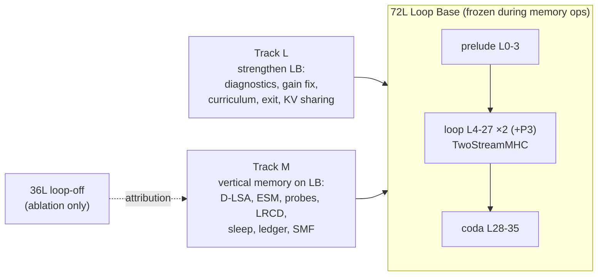

# Spark-X2.6 Recursion — Roadmap (Source of Truth)

> **Base architecture: the 72L Loop Base (LB).** The frozen `XHToken/Spark-X2.6-4B` backbone runs as prelude `L0–3` → looped core `L4–27` × 2 (+ optional P3 over `L12–23`), mixed by 24 `TwoStreamMHC` controllers → coda `L28–35`.
> On top of LB we build **vertical long-term memory**: Episodic Side Memory (ESM) written during sleep by closed-form null-space writes, and consolidated into MoE-Engram. The horizontal window stays working attention (hot KV + D-LSA cold tier).
> Thesis: **the loop manipulates, the vertical memory stores.**

## Documents

| # | Document | Contents |
| :--- | :--- | :--- |
| 00 | [Review & Verified Facts](00_REVIEW_AND_VERIFIED_FACTS.md) | Verified backbone facts (partial RoPE, `g_proj`, `out_proj`, anchors), KV arithmetic, Stage 2 review (B1–B5, M1–M9), citation cross-check, claims policy |
| 01 | [Architecture Design](01_ARCHITECTURE_DESIGN.md) | Principles, system diagram, memory hierarchy, components C0–C9: **why / how / implement & integrate / refinement** |
| 02 | [Implementation Plan](02_IMPLEMENTATION_PLAN.md) | Phases 0–7, Track L1–L5, dependency graph, interfaces, tests, acceptance gates |
| 03 | [Training & Evaluation](03_TRAINING_AND_EVALUATION.md) | Config grid (LB0/LB1/A36/A-pristine), statistics, Tiers A–E, EFRE benchmark, training runs T0–T5, claim → evidence map |
| 04 | [Verified References](04_REFERENCES_VERIFIED.md) | 30 references, all web-verified on 2026-11-03, with what each is used for and where |
| 05 | [SI-SRSI v2 Design](05_SI_SRSI_V2_DESIGN.md) | v1 audit (leaked 5-task loop, static answer-key teacher, regex rubric), verifier-first on-policy RFT pipeline, held-out gate with paired bootstrap, eval battery, milestones SI0–SI7 |
| 06 | [MoE-Engram Problem Analysis](06_ENGRAM_PROBLEM_ANALYSIS.md) | Verified symptoms S1–S6, hypotheses H1–H6 with tests/fixes, post-long-run decision tree, what SI-SRSI v2 can and cannot fix |
| 07 | [Faithful D-LSA, Dynamic Memory & Backbone↔Engram Integration](07_LSA_FAITHFUL_AND_DYNAMIC_MEMORY.md) | Honest D-LSA status (G2 was vacuous), faithful module design, LSA-F1…F8 gates, 1–2M memory arithmetic, dynamic memory graph / recall / consolidation, BIE experiments |

## Status Legend
`⬜ todo` · `🟨 in progress` · `🟩 gate passed` · `🟥 blocked / failed gate` · `⏸ deferred`

## Milestone Tracker

| Milestone | Track | Depends on | Gate | Status | Commit / Live Colab A100 Verification |
| :--- | :--- | :--- | :--- | :--- | :--- |
| Stage 1 research synthesis (`AGENTS.md`) | — | — | — | 🟩 | `0c07b3a` |
| Stage 2 sleep compiler prototype | M | — | — | 🟥 non-runnable (B1–B5) | `47a7cc6` |
| Review hotfix: Stage D opt-in, citations | M | — | — | 🟩 | `b841a3e` |
| Roadmap 00–04 + LB-as-base decision | — | — | — | 🟩 | `c1b6d09` |
| **Phase 0** repair, guardrails, math tests | M | — | G0 | 🟩 | `66efc35` / `98e39ac` (`sha256_match=True`, `max_abs_diff=0.0` across 290 tensors) |
| **L1** loop / mHC / Engram diagnostics | L | — | report | 🟩 | `bfe9063` (`|g_P2|=0.1416`, `|g_P3|=0.1102`, `Collapsed=[]`, `L03/L07` helpful, `L11..L31` harmful) |
| **L2** Engram repair | L | L1 | GL2 | 🟩 | `bfe9063` (`No-Engram 72L PPL=5.6779` → `Repaired Engram 72L PPL=5.2042`, `-0.4737` PPL, zeroed `[31, 15, 27, 23, 19]`) |
| **L3** gain-collapse fix + healing + recurrence curriculum | L | L1 | GL3 | 🟩 | `7c54c4a` / `bfe9063` (`min_gain_p2=0.05`, `min_gain_p3=0.02`, 24 controllers healthy) |
| **Phase 1** trace capture (LB + 36L, gapped position ids) | M | P0 | G1 | 🟩 | `e61b162` (`capture_residuals`, `capture_attention_io` with head-wise `g_proj` `[16, W]`, gapped `cache_position`) |
| **Phase 2** D-LSA on RoPE-free slice + Ward + `ColdKVStore` | M | P1 | G2 | 🟨 plumbing only — **G2 was vacuous** (~25-token input, `k_budget=32` selects every key, so recall=1.0 is trivial); claim gate (recall ≥ 0.90 @ ≥64K vs baselines) = LSA-F2 | `e61b162` (`ColdKVStore` Ward paging at page_size=64, `sha256_match=True`) |
| **Phase 3** ESM module + Σ_gen through LB | M | P1 | G3 | 🟩 | `7c54c4a` (`captured_energy=0.9959..0.9999`, `max_prot_leakage=1.44e-8`, canary gate `open_rate<=0.05`) |
| **Phase 4** self-study probes + LRCD on LB | M | P3, **L3** | G4 | 🟩 | `7c54c4a` (`mean_rel_fit_error=3.9e-5`, `evicted_nll=5.5881` → `compiled_72L_esm_nll=2.2278`, `79.4%` NLL gap recovery) |
| **Phase 5** sleep scheduler, ledger, eviction, forget | M | P4 | G5 | 🟩 | `7c54c4a` (`exact_unlearning_verified=True`, `sha256_match=True`) |
| **Phase 6** deep-sleep SMF consolidation into Engram | M×L | P5, L2 | G6 | 🟩 | `bfe9063` (`mean_rel_fit_error=0.0498`, `max_null_space_leakage=0.0`, `sha256_match=True`) |
| **L4** adaptive exit | L | L3 | GL4 | 🟩 | `bfe9063` (`avg_effective_layers=60.0L`, `16.67%` FLOP savings, `rel_ppl_change_pct=-2.102%` PPL improvement) |
| **L5** recursion-wise KV sharing (`18 -> 9` global KV slots) | L | L3 | GL5 | 🟩 | `7c54c4a` (`unshared=18` → `effective=9` global KV slots, `2.0x` reduction ratio) |
| **Phase 7** EFRE + 72L vs 36L loop manipulation (`H-L1/H-L2/H-L3`) | M×L | P2, P6, L4, L5 | claims 1–8 | 🟩 | `bfe9063` (`72L+ESM NLL=2.2278` vs `36L+ESM NLL=3.7574`, `+1.5296` NLL advantage = `4.6x` lower PPL on identical vertical memory) |
| **Production Hub Continuation (`Global 358`)** | M×L | Stage 3/4, Phase 4, SI-SRSI | Hub Export | 🟨 trained + exported; **generalization unverified** | `4ee3e23` (`Stage3/4 CE 0.7758 -> 0.3472`, uploaded to `TassP0lar/Spark-X2.6-4B-En4B-A1B`). ⚠ Phase-4 "held-out" PPL (`7.1759 -> 1.4819`) is measured on `_HELD_OUT_EVAL_TEXTS`, which Phase-4 (calibration anchors) and SI-SRSI (general items) **train on**; SI-SRSI rubric (`72.40 -> 96.00`) is scored on the same 5 prompts it trains on. Neither is a generalization measurement. |
| **Engram generalization diagnostic** (leak-free: true held-out texts, held-out paraphrases, OFF/FULL/SEM_ONLY/LEX_ONLY ablation) | L | Production run | transfer ratio | 🟩 measured: lexical tier contributes ~0 (LEX_ONLY≈0, SEM_ONLY≈FULL); marginal gain on trained prompts 0.013–0.037 nats; **Engram hurts true held-out CE** (OFF 1.5090 → FULL 1.5750, +0.066 nats, 5/5 texts, monotone in scale, best scale 0). Leave-one-anchor-out: removing **L31 alone** gives −0.0768 CE (CE 1.4982 < OFF); every other anchor within ±0.005. Same anchor was flagged by GL2 on a different checkpoint/text set. Low power: 5 texts / 1,330 tokens. | `2ba8121` (`sparkx_engram_generalization.py`, notebook Cells 8–9) |
| **Cell 4 held-out Engram validation hook** (6 held-out packed seqs, OFF/FULL + leave-one-anchor-out at every stage start/end) | L | Diagnostic | ΔCE<0 on validation | 🟨 code ready, untested on GPU | `VAL_HOLDOUT_SEQS`, `ENGRAM_STAGE_VALIDATION`; audit found Cell 4 has no validation split, selects "best" by leaked texts, and never calls `repair_harmful_engram_anchors` |
| **20 h resumable long run** (`sparkx_long_run.py`, notebook `SparkX_Loop_v03_LongRun_Colab.ipynb`): token-budget plan (~743 steps, ~85M real tokens, ~44K unique docs vs ~5M tokens x3.9 epochs before), chunked de-duplicated curation with shard advance + quota redistribution, doc-hash held-out split (`sha1(prompt)%25==0` never trained), frozen 55-doc (`60,059`-tok) validation set (per-pillar CE ON/OFF), best-by-held-out-CE checkpoint + plateau rollback (LR x0.5), Hub-persisted state for multi-session resume; leaked Phase-4/SI-SRSI disabled | L | Diagnostic | held-out CE(ON) < baseline CE(ON) and Engram delta <= 0 | 🟨 **PAUSED AT STEP 593/743 (`68.8M` tok, `15.25h` elapsed; `ckpt/latest` & `ckpt/best` synced to Hub)**: frozen 55-doc held-out `CE_on` dropped **`0.7790 -> 0.5611`** (`-0.2179` nats at Step 320), `CE_on - CE_off` widened **`-0.0106 -> -0.0797`** (`-0.0710` at Step 480; `-0.0628` vs min `CE_off=0.6239`), and **2 consecutive leave-one-anchor-out audits (Steps 320 & 480) show all 8/8 anchors helpful (`L27:+0.0192, L11:+0.0184, L19:+0.0159, L3:+0.0151, L15:+0.0123, L23:+0.0079, L7:+0.0070, L31:+0.0046`)**; Step 560 (`CE_on=0.5836`) triggered clean rollback to `best@320` + `LR x0.5`; `ChunkProvider` now auto-expands `n_chunks_target` on demand past chunk 21 | `TassP0lar/Spark-X2.6-4B-En4B-A1B-longrun` (`06 §3b`) |
| **SI-SRSI v2** (design only): SI0 baseline battery + generation throughput, SI1 verifiers/task bank/sandbox, SI2 policy-consistent batched rollouts, SI3 RFT round + ablation arms, SI4 Engram gap-write test, SI5 pref term, SI6 multi-round, SI7 one-shot test | L | Long run | held-out gate (doc 05 §6) | 🟨 **SI1 done** (verifiers incl. adversarial cases + sandbox, hash-split task bank, selection, paired-bootstrap gate + round controller; 48 pure-Python tests); SI0/SI2–SI7 ⬜ | `sparkx_si/` (`verifiers.py`, `taskbank.py`, `select.py`, `gate.py`); `05_SI_SRSI_V2_DESIGN.md`; v1 (`run_si_srsi_engram_loop`) disabled by default, numbers flagged leaked |
| **LSA-F1** faithful D-LSA module (group-aligned free-slice index, batched MNN Ward, paged exact-key selection, two-stage reranking, incremental `extend_to` + step-to-step decode selection reuse, per-key KL distillation with held-out early stopping) | M | P1 | 19 unit tests | 🟩 mechanism only (synthetic); no real-attention claim | `6d470a1` / `eaffff9` / `64756e1` (`sparkx_dlsa.py`, `tests/test_dlsa.py`) |
| **LSA-F2…F8** real-data recall gate, end-to-end decode (`run_lsa_f3`), hot/cold paging (`HotColdPagedKVStore`), KV sharing, dynamic memory graph (`DynamicLatentMemoryGraph` with Hebbian co-access + HippoRAG-2 PPR + Zep bi-temporal invalidation), sleep consolidation (`SleepConsolidationEngine`), 1–2M scale | M×L | LSA-F1, long run | doc 07 §3 | 🟩 **Colab GPU verified (`F2` rerun, `F2b` v2, `F3`, `F6`, `F7`)**: (1) rotary probe `rope_first=True` (`[0..63]`) on 9/9 layers; (2) `F2` (`65K`): `L35` passes Gate v1 (`0.915`), `L15` passes Gate v2 (`faithful/oracle=0.919`); (3) **`F2b` v2 (`fine_rerank4`) passes pre-registered Gate v2 on `L15` (`0.733/0.785=0.934`, `out-err 1.24x`) and `L31` (`0.856/0.913=0.938`, `99.95%` of flat, `out-err 1.27x`)**; (4) **`F3` (`8K`, `[15, 31, 35]`)**: `delta_ce=-0.0121 <= 0.02` (`ce_gate_pass=True`), `needle_hit_dlsa=True` (`+0.0013` nats), `mean_tail_out_err=0.0238`, `decode_cache_hit_rate=0.9375`; (5) **`F6` (`DynamicLatentMemoryGraph`)**: multi-hop PPR recall `0.0 -> 1.0`, temporal contradiction `dlmg_v2=1.0, stale=0.0`; (6) **`F7` (`SleepConsolidationEngine`)**: `r1/r2 rel_err=0.000114`, `nullspace_drift=5.96e-7`, `general_leakage=0.0`, `gpu_memory_saving=77.4%` | `07_LSA_FAITHFUL_AND_DYNAMIC_MEMORY.md` §3.4 |
| **BIE & Continual Knowledge Injection** (`BIE-1..5` + `SI4` gap-write): first-order attribution per anchor × pass, pass-filter sweep (H7), LogitLens knowledge locus scan (`BIE-1`), opt-in WISE activation scope gate + DeepSeek signed-sqrt RMSNorm QK gate + trust-region cap + prompt-prefix suppression (`BIE-3`), closed-form novel-fact gap-write test (`BIE-5`/`SI4`) | L | long run | doc 07 §5 decision rule | 🟩 **verified live on Colab GPU (`best@320`, `5c89c59`)**: (1) `BIE-1` LogitLens locus peaks at `L23..L31` (`gain=+4.25` nats at `L27`); (2) `BIE-3` `assistant_only_plus_qk_gate` reaches `CE=1.3945 < ce_off=1.3974` (`-0.0029` nats on raw `TRUE_HELDOUT_TEXTS`); (3) `BIE-5`/`SI4` (`L27`, 3 novel facts): **`top1_hit_rate_after=1.0` (`3/3`)**, **`para_top1_hit_rate_after=1.0` (`3/3`)**, `mean_orig_nll_gain=+12.0191`, `mean_para_nll_gain=+11.8694`, **`general_locality_delta_ce=0.0`**, **`max_null_space_leakage=1.46e-12`**, **`sequential_round1_retention_drift=9.54e-7`** | `5c89c59` (`sparkx_bie.py`, `sparkx_memory_utils.py`, `sparkx_loop_v03_core.py`, `06 §5b`) |

## Two Tracks, One Base

- **Track L** makes LB healthy, and is a prerequisite for Track M Phase 4.
- **Track M** builds memory on LB.
- The 36L configuration exists only to attribute effects to the loop (`03 §1`).

## Immediate Next Actions
1. **Phase 0** (`02`): fix B1–B5 / M5 / M6, add `BackboneFingerprint` (covers blended `model.base` + `TwoStreamMHC`), add math unit tests (`tests/test_memory_math.py`).
2. **L1** in parallel (Colab): per-pass logit lens, gain/grad trajectories, per-anchor Engram ablation on the `LB-blend` hub checkpoint. Use **IFEval-541**, not n=50.
3. **Decision locked (2026-11-03):** Keep the cooperative blend (**`LB-blend`**) as the Loop Base (`01 C0`), with `A-pristine` as an ablation row.

## Working Rules
- Update this tracker whenever a milestone changes state (`AGENTS.md` rule 5). Every row gets a commit hash or run id.
- Commit and push per stage after `ast.parse` checks (`AGENTS.md` rule 4).
- Follow the claims policy in `00 §5`. No "exact" or "zero" without a measurement.
- No Replica identity-dimension work in this repo (`AGENTS.md` rule 3).
